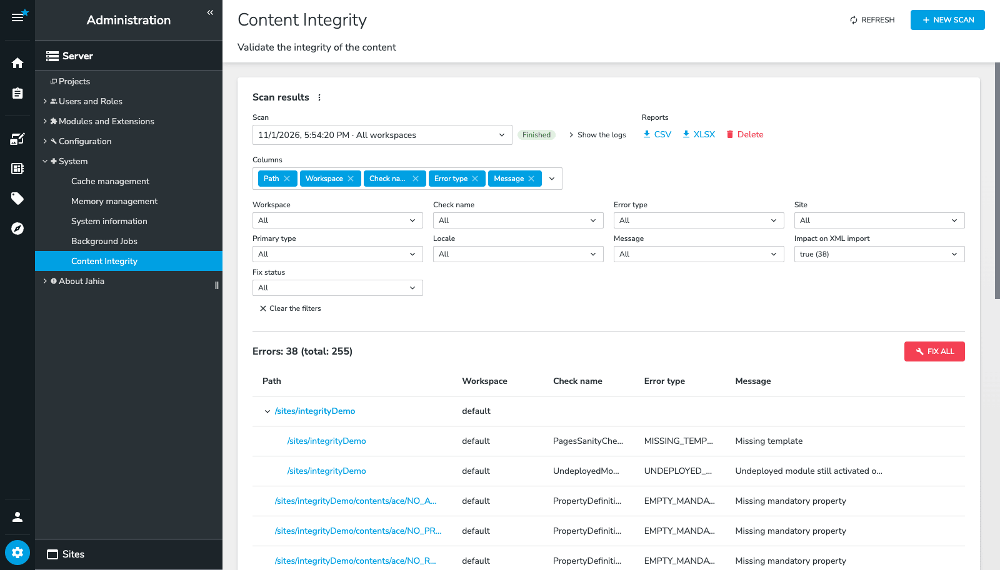
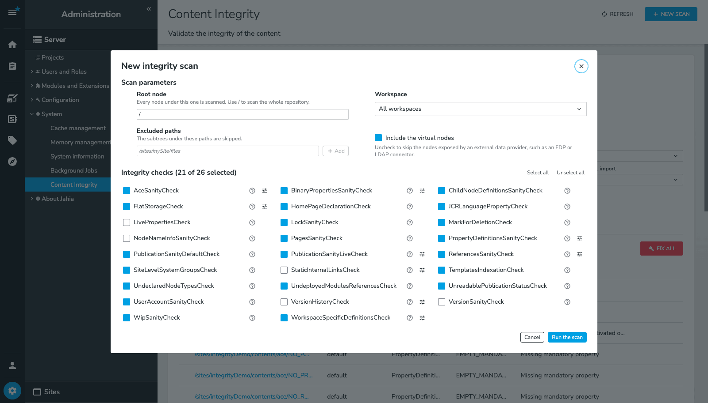
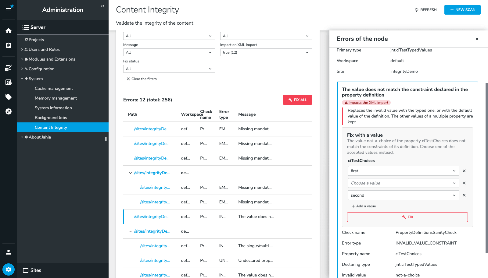

# Content Integrity
Jahia module that provides an extensible service to test the integrity of the content

> [!CAUTION]
> **This module is a community module: it is not supported by the Jahia Engineering team**, and comes without any
> warranty. Try it on a copy of your environment before running it in production. Feel free to report any issue or idea
> through a GitHub issue, or through your access to https://support.jahia.com.
>
> **Fixing the errors changes the JCR, and can't be undone.** A scan only reads the content, but a fix writes to the
> repository with a system session, whatever the permissions on the node: depending on the error, it deletes nodes and
> their subtree, properties or access control entries, changes values, or publishes content. Back up the repository
> before fixing errors in production, read what each fix does in the [documentation of the checks](docs/embedded-tests.md#summary),
> and narrow the filters to the errors to fix before using **Fix all** or `jcr:integrity-fix *`.

> [!CAUTION]
> **Ce module est communautaire : il n'est pas supporté par l'équipe Engineering Jahia**, et n'est fourni avec aucune
> garantie. Essayez-le sur une copie de votre environnement avant de l'exécuter en production. N'hésitez pas à reporter
> toute anomalie ou idée via une issue GitHub, ou bien via votre accès https://support.jahia.com.
>
> **La correction des erreurs modifie le JCR, de façon irréversible.** Une analyse ne fait que lire le contenu, mais une
> correction écrit dans le référentiel avec une session système, quelles que soient les permissions sur le nœud : selon
> l'erreur, elle supprime des nœuds et leur sous-arbre, des propriétés ou des entrées de contrôle d'accès, modifie des
> valeurs, ou publie du contenu. Sauvegardez le référentiel avant de corriger des erreurs en production, lisez ce que fait
> chaque correction dans la [documentation des contrôles](docs/embedded-tests.md#summary), et restreignez les filtres
> aux erreurs à corriger avant d'utiliser **Fix all** ou `jcr:integrity-fix *`.

* [How to use it](#how-to-use)
    * [Configuration](#configuration)
    * [UI](#how-to-use-ui)
    * [Karaf Shell commands](#karaf-shell-commands)
        * [jcr:integrity-check](#jcrintegrity-check) 
        * [jcr:integrity-printError](#jcr-integrity-printError) 
        * [jcr:integrity-printChecks](#jcr-integrity-printChecks) 
        * [jcr:integrity-printTestResults](#jcr-integrity-printTestResults) 
        * [jcr:integrity-configureCheck](#jcr-integrity-configureCheck) 
        * [jcr:integrity-fix](#jcrintegrity-fix) 
* [Embedded tests](docs/embedded-tests.md#summary)
* [FAQ](#faq)
* [How to extend it](docs/how-to-extend.md#summary) 
* [Groovy scripts](docs/groovy-scripts.md#summary)
* [Release notes](docs/release-notes.md#summary) 
* [Cypress tests](tests/README.md)

## How to use?

### Configuration

Three permissions, granted at server level, control the feature:

* `adminContentIntegrity` allows to run an integrity scan, to configure the checks and to read the results.
* `adminContentIntegrityFix` allows to fix the errors, one at a time or all the errors matching the filters. A fix writes to the repository with a system session, whatever the ACL of the fixed node, so this permission is not granted by `adminContentIntegrity`. Without it, the administration screen offers no fix, and the GraphQL fields `fixError` and `fixAllErrors` are refused.
* `adminContentIntegrityDelete` allows to delete the results of a scan, or of all the scans, with their CSV and XLSX reports, which can't be undone. It is not granted by `adminContentIntegrity` either. Without it, the administration screen offers no deletion, and the GraphQL fields `deleteScanResults` and `deleteAllScanResults` are refused. The deletion also requires to read the reports, which only the server administrators do.

By default, the three permissions are added to the role `server-administrator` only, thus any server administrator is able to use the feature, to fix the errors and to delete the results. To delegate the scans only, grant a server role holding `adminContentIntegrity`, plus `administrationAccess` to open the administration.

The command `jcr:integrity-fix` of the Karaf console is not controlled by these permissions, since the access to the console already requires to be a system administrator.

### UI

The module adds a page to the administration, under **Server > System > Content Integrity**. The page displays the scan which runs, if any, and the results of the stored scans. Use **New scan** to run a scan.

#### Run a scan

**New scan** opens a dialog to configure the scan. The dialog keeps the selection and the parameters from one scan to the next.

All the available checks, provided by the module itself or by extensions, are listed. Those configured as active are preselected. Use **Select all** and **Unselect all** to change the selection quickly.

Each check has a help button that opens its documentation. A configurable check also has a configure button, which opens a dialog to edit its parameters. The dialog can also reset them to their default values.

The scan is executed on a tree, by default on the whole JCR, starting from its root node. To scan a single site, a specific section, the files hierarchy of a site, ... , specify the related root node as the root of the scan.

All the nodes under the specified one will be scanned, unless some subtrees are specified to be excluded. If needed, add the path of the root nodes of those trees to skip, then click on a path to remove it from the list.

The scan can be run on a single workspace, or on both.

Virtual nodes (e.g. exposed by an EDP connector) can be excluded from the scan. This is useful when processing those nodes involves a lot of connections to a 3rd party system, with an important impact on the duration of the scan.

#### Follow the scan

While a scan runs, a card displays it above the results, with its start date and its logs, and **Stop** interrupts it at the end of its current step. The scan is run in background, and leaving the page will have no impact on its execution: when coming back to the page, the running scan is displayed again.

The page opens, and reopens once reloaded, without any results selected: choose a scan in **Scan** to display its results. When a scan launched from the page is over, its results are displayed, and its reports can be downloaded from the JCR (uploaded under `/sites/systemsite/files/content-integrity-reports`). A report describes the whole scanned repository, so the reports folder is readable by the server administrators only: the role `privileged`, which every editor of every site holds on the system site, is denied on it. Each scan of the results tells its status, finished, interrupted or failed, and keeps its log, displayed with **Show the logs**. The errors of a scan which did not finish are not displayed, since they do not cover the whole tree.

The **Delete** action, next to the reports, deletes the results of the selected scan, after a confirmation: its errors, its log, and its CSV and XLSX reports. The page then displays no results until a scan is chosen, as after **Refresh**. The content is not changed, and the errors not fixed are detected again by the next scan. It is offered to the users who hold `adminContentIntegrityDelete`, for the scans which are not running.

**Delete all**, in the menu after the title **Scan results**, deletes the results of all the scans, except the ones of a running scan, after a confirmation, which is enabled once the box **Be careful, data are going to be altered in this environment** is ticked. The page then displays **No scan results yet**. The menu is displayed to the users who hold `adminContentIntegrityDelete` only.

#### Explore the results

Select the scan to display, by its date and its workspace, and choose the columns to display: the path, the workspace, the check name, the error type and the message are displayed by default. The filters are always displayed, and filter the errors on the workspace, the check, the error type, the site, the node type, the locale, the message, the impact on the XML import or the fix status. Each filter value shows its number of errors. By default, only the errors which make the XML import fail are displayed: **Clear the filters** displays all of them.

**Fix all** runs the fix of every error matching the filters, after a confirmation, which is enabled once the box **Be careful, data are going to be altered in this environment** is ticked, then displays how many errors were fixed, not fixed, skipped and already fixed. Each error fixed or not fixed is tagged as such in its row. The errors whose check provides no fix, the ones fixed with a chosen or typed value, and the ones whose node does not exist anymore are skipped. Some fixes remove content, so narrow the filters to the errors to fix first.

The errors are grouped by node: the errors of a node which has several of them follow a row which tells its path and its workspace, and whose chevron hides or shows them. Click on the path or the UUID of a node to open it in the JCR browser of the `tools` area. A click on the row of an error, or Enter on it, opens the errors of its node in a side panel: the node, then each of its errors with all its information, including the extra information provided by the check, and **Fix**, which runs the fix of the check which has detected it, when the check provides one. **Fix all**, in the panel, fixes together the errors of the node which can be fixed now. Like **Fix all** of the results, every fix of the panel, from its buttons or from Enter in the field of a value, is run once confirmed, after the box **Be careful, data are going to be altered in this environment** is ticked. The errors of a virtual node, served by an external provider such as a mount point, are not fixed from the panel, and the panel tells when the node has been removed since the scan, for example by the fix of another error. A click on another row displays the errors of its node in the same panel, and Escape closes it. An error fixed with a value has the field of the value in the panel, and **Fix** sends it: a missing mandatory property, a value which breaks the constraints of its definition, chosen among the accepted values, a missing template, chosen among the templates available to the page, or the missing roles of an access control entry, chosen among the roles which can be given at its place. The outcome of a fix, **Fixed** or **Not fixed**, stays displayed in the first column of the row.

The results are stored in the JCR, under `/sites/systemsite/files/content-integrity-reports`, from the start of their scan: they remain available after a restart. The reports older than 30 days are deleted by a background job, configured by `org.jahia.modules.contentintegrity.reports` (`retentionDays`, 0 to keep them all, and `cleanupIntervalHours`). The CSV and XLSX reports uploaded in this folder by a version 3.x of the module are kept after an upgrade, readable by the server administrators only, but they are neither listed nor deleted by this job: delete them by hand once they are no longer needed.

### Karaf Shell commands
The content integrity service is available through the [Karaf console](https://academy.jahia.com/documentation/system-administrator/jahia/8/installing-and-configuring-jahia/installing-configuring-and-troubleshooting-jahia/configuring-jahia-features#osgi-ssh-console).

Use `jcr:cd {path}` to position yourself on the node from which you want to start the scan.

Use `jcr:workspace {workspace}` if you want to change the workspace to scan.

Use `jcr:integrity-check` to run a content integrity test.

    jahia@dx()> jcr:cd /sites/mySite/
    /sites/mySite
    jahia@dx()> jcr:integrity-check
    Content integrity tested in 128 ms
    No error found
    jahia@dx()>
    
#### jcr:integrity-check  
Runs a scan of the current tree and current workspace.

**Options:**  

| Name     | alias     |         Value          | Mandatory | Multiple | Description                                                                                                                                                                                                                                                                                                                                                                             |
|----------|-----------|:----------------------:|:---------:|:--------:|-----------------------------------------------------------------------------------------------------------------------------------------------------------------------------------------------------------------------------------------------------------------------------------------------------------------------------------------------------------------------------------------|
| -l       | --limit   | positive integer, [20] |           |          | Specifies the maximum number of errors to print out                                                                                                                                                                                                                                                                                                                                     |
| -x       | --exclude |         string         |           |    x     | Specifies one or several subtrees to exclude                                                                                                                                                                                                                                                                                                                                            |
| -c       | --checks  |         string         |           |    x     | Specifies the checks to execute, specified by their ID.   Only the specified checks will be executed during the current scan, no matter the global configuration.  The check IDs can also be prefixed with ':' to specify a check to be skipped. In such case, the scan will execute all the currently active checks but those specified to be skipped during the current scan. |
| --skipMP |           |                        |           |          | If specified, the virtual nodes are excluded from the scan                                                                                                                                                                                                                                                                                                                              |

**Examples:**

    jcr:cd /sites/mySite/
    jcr:workspace live
    jcr:integrity-check -l 10   
    
    jcr:cd /sites
    jcr:integrity-check -x /sites/aHugeSite
    jcr:integrity-check -x /sites/aHugeSite -x /sites/anotherHugeSite/files 
                                                              
A scan can be interrupted before the end of its execution. Refer to the [FAQ section](#scan-interruption) for more details.

#### jcr:integrity-printError
Prints out some extended information about an error.

**Argument:**

| Value  | Mandatory | Multiple | Description                     |
|:------:|:---------:|:--------:|---------------------------------|
| string |     x     |    x     | ID of the error(s) to print out |

**Options:**

| Name | alias  | Value  | Mandatory | Multiple | Description                                                                  |
|------|--------|:------:|:---------:|:--------:|------------------------------------------------------------------------------|
| -t   | --test | string |           |          | ID of the test from which to load the error. Latest test used if not defined |

**Example:**

    jcr:cd /sites/mySite/
    jcr:integrity-check 
    Content integrity tested in 44 seconds (44609 ms)
    ID | Fixed | Error                          | Workspace | UUID                                 | Node type         | Locale | Message
    --------------------------------------------------------------------------------------------------------------------------------------------------------
    0  |       | PropertyConstraintsSanityCheck | default   | c847913d-64f1-4c23-a6f6-1b7833f8024f | jnt:page          | fr     | Missing mandatory property
    1  |       | PropertyConstraintsSanityCheck | default   | a60dc57a-0bd3-4908-9b58-7e60dc558a34 | jnt:page          | fr     | Missing mandatory property
    2  |       | PropertyConstraintsSanityCheck | default   | dbb81015-5cac-4887-90d5-68c9be704ac8 | mynt:internalLink | fr     | Missing mandatory property
    
    jahia@dx()> jcr:integrity-printError 2
    ID             | 2
    Check name     | PropertyConstraintsSanityCheck
    Check ID       | PropertyConstraintsSanityCheck
    Fixed          | false
    Workspace      | default
    Locale         | fr
    Path           | /sites/mySite/home/missions/internalLink-3
    UUID           | dbb81015-5cac-4887-90d5-68c9be704ac8
    Node type      | mynt:internalLink
    Mixin types    |
    Message        | Missing mandatory property
    property-name  | node
    error-type     | EMPTY_MANDATORY_PROPERTY
    declaring-type | mynt:internalLink

#### jcr:integrity-printChecks 
Prints out the currently registered checks. 
                         
**Options:**

| Name | alias         |      Value      | Mandatory | Multiple | Description                       |
|------|---------------|:---------------:|:---------:|:--------:|-----------------------------------|
| -l   | --outputLevel | [simple] , full |           |          | Specifies the output level to use |

**Example:**

    jahia@dx()> jcr:integrity-printChecks
    Integrity checks (26):
       FlatStorageCheck (id: FlatStorageCheck, priority: 0.0, enabled: true)
       AceSanityCheck (id: AceSanityCheck, priority: 100.0, enabled: true)
       [...]
       LivePropertiesCheck (id: LivePropertiesCheck, priority: 100.0, enabled: false)
       [...]
       WorkspaceSpecificDefinitionsCheck (id: WorkspaceSpecificDefinitionsCheck, priority: 100.0, enabled: true)
 
#### jcr:integrity-printTestResults   
Allows to reprint the result of a previous test.   

**Argument:**

| Value  | Mandatory | Multiple | Description                                                         |
|:------:|:---------:|:--------:|---------------------------------------------------------------------|
| string |           |          | ID of the test whose results to print. Latest test used if not defined |

**Options:**

| Name | alias                |         Value          | Mandatory | Multiple | Description                                                                                                                      |
|------|----------------------|:----------------------:|:---------:|:--------:|----------------------------------------------------------------------------------------------------------------------------------|
| -l   | --limit              | positive integer, [20] |           |          | Specifies the maximum number of errors to print out                                                                              |
| -d   | --dump               |                        |           |          | Dumps the errors into report files in temp/content-integrity/ if used. The limit option is ignored when dumping                  |
| -u   | --upload             |                        |           |          | Uploads the report files in the JCR instead of writing in on the filesystem. This option has no effect if not combined with `-d` |
| -ef  | --excludeFixedErrors |                        |           |          | Leaves out the errors which are already fixed                                                                                    |

**Example:**

    jahia@dx()> jcr:integrity-check
    Content integrity tested in 141 ms
    No error found
    jahia@dx()> jcr:integrity-printTestResults -d
    Dumped into /usr/local/tomcat/temp/content-integrity/default_2026_10_30-13_34_15_786-full.csv
    Dumped into /usr/local/tomcat/temp/content-integrity/default_2026_10_30-13_34_15_786-full.xlsx
 
#### jcr:integrity-configureCheck   
Allows to configure a registered integrity check. Please note that for the moment, the configuration is reset when restarting the module implementing the check,
or when restarting the server.   
                         
**Options:**

| Name | alias          |    Value    | Mandatory | Multiple | Description                                                                                                                                         |
|------|----------------|:-----------:|:---------:|:--------:|-----------------------------------------------------------------------------------------------------------------------------------------------------|
| -id  |                |   string    |     x     |          | Specifies the identifier of the integrity check to configure                                                                                        |
| -e   | --enabled      | true, false |           |          | Enables the integrity check if `true`, disable it if `false`. Do not change the current status if not defined                                       |
| -p   | --param        |   string    |           |          | Name of the parameter to configure. Depends on the integrity check specified with `-id`. If no value is specified, the current value is printed out |
| -v   | --value        |   string    |           |          | Value of the parameter to configure. Depends on the parameter specified with `-p`. Depends on the integrity check specified with `-id`              |
| -rp  | --resetParam   |   string    |           |          | Name of the parameter to reset to its default value                                                                                                 |
| -pc  | --printConfigs |   string    |           |          | Print all the configurations of the specified check                                                                                                 |

**Example:**

    jahia@dx()> jcr:integrity-printChecks
    Integrity checks (26):
       FlatStorageCheck (id: FlatStorageCheck, priority: 0.0, enabled: true)
       [...]
    jahia@dx()> jcr:integrity-configureCheck -id FlatStorageCheck -e false
    jahia@dx()> jcr:integrity-printChecks
    Integrity checks (26):
       FlatStorageCheck (id: FlatStorageCheck, priority: 0.0, enabled: false)
       [...]
    jahia@dx()> jcr:integrity-configureCheck -id FlatStorageCheck -pc
    FlatStorageCheck:
        threshold = 500 (Number of children nodes beyond which an error is raised)
    jahia@dx()> jcr:integrity-configureCheck -id FlatStorageCheck -p threshold
    FlatStorageCheck: threshold = 500
    jahia@dx()> jcr:integrity-configureCheck -id FlatStorageCheck -p threshold -v 200
    FlatStorageCheck: threshold = 200
    jahia@dx()> jcr:integrity-configureCheck -id FlatStorageCheck -rp threshold
    FlatStorageCheck: threshold = 500

 
#### jcr:integrity-fix
Fixes some errors of a scan, using the fix provided by the check which has detected them. The errors are specified by their ID, as printed by `jcr:integrity-printTestResults`, or `*` for all the errors which are not fixed yet.

**Options:**

| Name | alias  | Value  | Mandatory | Multiple | Description                                                                      |
|------|--------|:------:|:---------:|:--------:|----------------------------------------------------------------------------------|
| -t   | --test | string |           |          | ID of the scan from which to load the errors. Latest scan used if not defined    |

**Example:**

    jahia@dx()> jcr:integrity-fix 3 7
    Fixed the error id=3
    Impossible to fix the error id=7
    jahia@dx()> jcr:integrity-fix *

Not every error type can be fixed automatically. When a check provides no fix for an error, the error is reported as impossible to fix.

## FAQ

### Scan interruption

You can interrupt a running scan from the UI, or by defining a system property named `modules.contentIntegrity.interrupt`. 
You can for example run the following script in a groovy console:

    System.setProperty("modules.contentIntegrity.interrupt", "true")

### Clustered environment

Most of the checks are purely related to the JCR, and do not need to be executed on every server in the cluster. The scan can be run on any server, not just the processing server.

The content is shared by the servers of a cluster, but each server has its own search index, and its own modules started. The following checks rely on these local resources, and should be run on every server in a cluster:
* `TemplatesIndexationCheck`: the templates are looked up in the search index
* `PagesSanityCheck`: `MISSING_TEMPLATE`, the templates are resolved with the search index and the modules started on the server
* `AceSanityCheck`: `MISSING_EXTERNAL_ACE` and `ACE_NON_GRANT_WITH_EXTERNAL_ACE`, the external entries are found with the search index
* `ReferencesSanityCheck`: `INVALID_BACK_REF`, the weak references are found with the search index (only when `validate-back-refs` is enabled)
* `UndeclaredNodeTypesCheck`: a type is undeclared when its module is not started on the server
* `UndeployedModulesReferencesCheck`: the modules of the sites are compared with the modules deployed on the server

An error reported on some servers only comes from their index or their modules, not from the content: reindex, or deploy and start the module, on these servers rather than fixing the error, since a fix changes the content for the whole cluster. The fix of `GROUP_DOES_NOT_EXIST` (`SiteLevelSystemGroupsCheck`) also finds the members of the group with the search index: run it on a server whose index is up to date. See the documentation of each check in [Embedded tests](docs/embedded-tests.md#summary).

In the UI, the checks to execute can be easily selected. If using the Karaf Shell, refer to [jcr:integrity-check](#jcrintegrity-check) to run a scan with a specified list of checks to execute.
