# <a name="summary"></a>Content Integrity - Embedded tests
* [How to use it](../README.md#summary)
* Embedded tests
  * [AceSanityCheck](#acesanitycheck)
  * [BinaryPropertiesSanityCheck](#binarypropertiessanitycheck)
  * [ChildNodeDefinitionsSanityCheck](#childnodedefinitionssanitycheck)
  * [FlatStorageCheck](#flatstoragecheck)
  * [HomePageDeclarationCheck](#homepagedeclarationcheck)
  * [JCRLanguagePropertyCheck](#jcrlanguagepropertycheck)
  * [LivePropertiesCheck](#livepropertiescheck)
  * [LockSanityCheck](#locksanitycheck)
  * [MarkForDeletionCheck](#markfordeletioncheck)
  * [NodeNameInfoSanityCheck](#nodenameinfosanitycheck)
  * [PagesSanityCheck](#pagessanitycheck)
  * [PropertyDefinitionsSanityCheck](#propertydefinitionssanitycheck)
  * [PublicationSanityDefaultCheck](#publicationsanitydefaultcheck)
  * [PublicationSanityLiveCheck](#publicationsanitylivecheck)
  * [ReferencesSanityCheck](#referencessanitycheck)
  * [SiteLevelSystemGroupsCheck](#sitelevelsystemgroupscheck)
  * [StaticInternalLinksCheck](#staticinternallinkscheck)
  * [TemplatesIndexationCheck](#templatesindexationcheck)
  * [UndeclaredNodeTypesCheck](#undeclarednodetypescheck)
  * [UndeployedModulesReferencesCheck](#undeployedmodulesreferencescheck)
  * [UnreadablePublicationStatusCheck](#unreadablepublicationstatuscheck)
  * [UserAccountSanityCheck](#useraccountsanitycheck)
  * [VersionHistoryCheck](#versionhistorycheck)
  * [VersionSanityCheck](#versionsanitycheck)
  * [WipSanityCheck](#wipsanitycheck)
  * [WorkspaceSpecificDefinitionsCheck](#workspacespecificdefinitionscheck)
* [How to extend it](how-to-extend.md#summary)
* [Groovy scripts](groovy-scripts.md#summary)
* [Release notes](release-notes.md#summary)

Fixing integrity issues can be a complex operation. This page will help you to deal with the various issues you might identify, giving a general way to solve those issues. But some project specificities might need to be considered to build a tailored made answer. If you need some assistance, do not hesitate to reach out to the [Jahia Professional Services Team](services@jahia.com).

## AceSanityCheck

Checks the access control entries (`jnt:ace`, including the external entries `jnt:externalAce`), in every workspace.

When a role is granted to a principal (a user or a group) on a node, an access control entry is written in the `j:acl` sub-node of this node. It holds the principal (`j:principal`, such as `u:john` or `g:editors`), the type of the entry (`j:aceType`, `GRANT` or `DENY`) and the roles (`j:roles`).  
A role can also declare external permissions (a `jnt:externalPermissions` sub-node of the role, whose `j:path` tells where they apply, such as `currentSite` for the site of the node). When such a role is granted, the ACL listener of Jahia writes an external entry at this place, named `REF<role>_<external permissions>_<principal>`, for example `REFeditor_currentSite-access_u_john` in the ACL of the site. The external entry references the entries it comes from, the source entries, in its property `j:sourceAce`. Several entries granting the same role to the same principal share a single external entry.

The roles are read under `/roles` in the `default` workspace when the scan starts. A sub-role inherits the external permissions of its parent role.

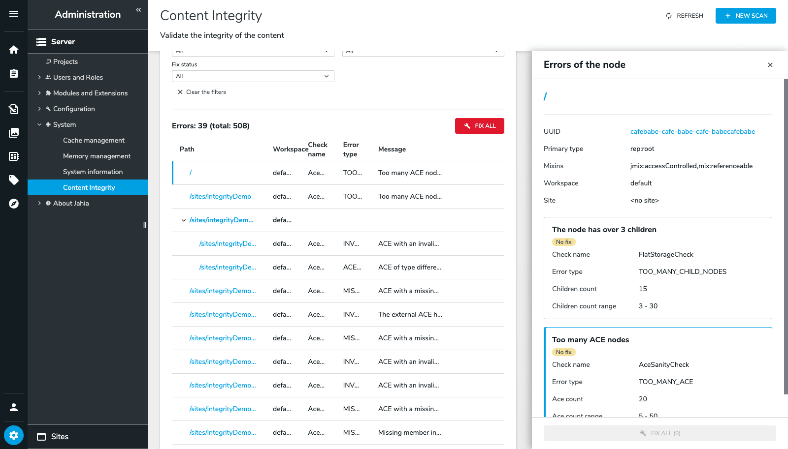

### Configuration

| Name                |  Type   | Default Value | Description                                                                                                       |
|---------------------|:-------:|:-------------:|-------------------------------------------------------------------------------------------------------------------|
| ace-count-threshold | integer |     1000      | Number of ACE nodes for a single site from which an error is raised (the ACE out of the sites are counted together) |

### Dealing with errors

Most of these errors are the consequence of an access control entry, or of a role, written or deleted without the listeners of Jahia: by a script, an import, or a module.  
When an entry is deleted or altered in the `default` workspace, the change has to be published, otherwise the former permissions remain in `live`.

#### Missing principal

`Error code: NO_PRINCIPAL`

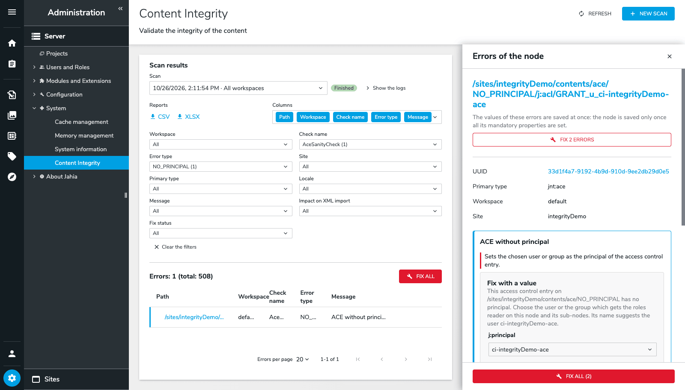

**Description**: the entry has no property `j:principal`. Nobody can be granted its roles, and its expected name can't be calculated.

The name of the entry usually tells its principal: `GRANT_u_john` is the entry of the user `john`.

**Fix**: in the details of the error, in the administration screen, choose the principal in a dropdown, then click **Fix**. The dropdown lists the users and the groups which the entry can name: the ones of the server, and on a site, the ones of the site, in two groups, Users then Groups. When the principal told by the name of the entry exists, it is suggested. The entry is saved with the listeners enabled, so that the ACL listener updates what depends on it, such as the external entries of a role. **Fix all** skips this error. Without a value, as from the command `jcr:integrity-fix`, the fix deletes the entry, as for `NO_ACE_TYPE_PROP`.

#### Invalid principal

`Error code: INVALID_PRINCIPAL`

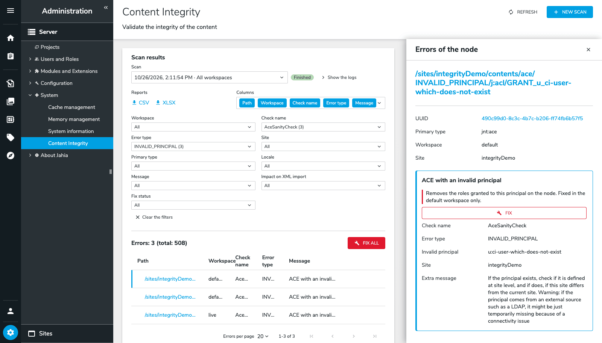

**Description**: the principal of the entry can't be found. A user (`u:`) is looked up in the site of the entry, then at server level, a group (`g:`) in the site of the entry, then at server level. A principal which starts with neither `u:` nor `g:` is invalid as well.  
The details tell the invalid principal and the site.

If the principal exists, check if it is defined at site level, and if so, if its site differs from the site of the entry: a principal of a site can't be granted roles in another site.

**Warning**: if the principal comes from an external source, such as a LDAP, it might be only temporarily missing, because of a connectivity issue. In such case, the error is a false positive, and must not be fixed.

**Fix**: removes the roles granted to this principal on the node. Fixed in the `default` workspace only: the change is not published, publish the node, or its ACL, to clean the `live` workspace.

#### Missing or invalid type

`Error code: NO_ACE_TYPE_PROP`

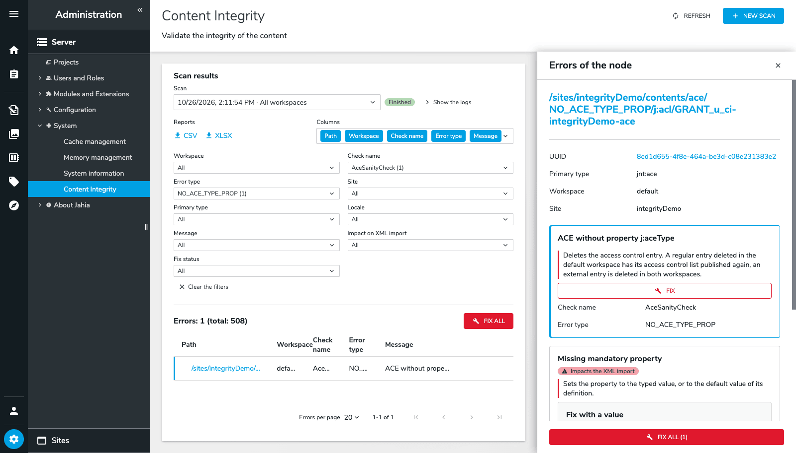

**Description**: the entry, regular or external, has no property `j:aceType`. Its roles can't be known as granted or denied, and a regular entry without type is handled as an entry which is not of type `GRANT`.

`Error code: INVALID_ACE_TYPE_PROP`

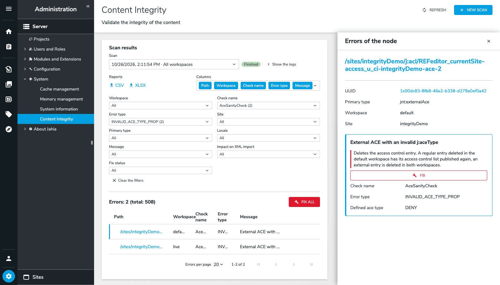

**Description**: the external entry has a `j:aceType` different from `GRANT`. External entries are written only for the entries of type `GRANT`. The details tell the type found.

If the permissions of a regular entry are needed, grant the role again from the UI once the entry is deleted.

**Fix**: deletes the access control entry. A regular entry is deleted with the listeners enabled, so that its external entries are cleaned as well, and in the `default` workspace, its access control list is published again: the whole node when it had no pending modification, only its ACL otherwise. An external entry is deleted from both workspaces, and an ACL left empty is deleted.

#### Invalid node name

`Error code: INVALID_NODENAME`

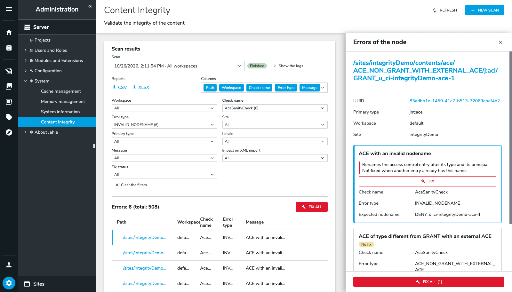

**Description**: the name of the entry is not the one calculated from its content. A regular entry is named `<type>_<principal>`, such as `GRANT_u_john`, and an external entry `REF<role>_<external permissions>_<principal>`, the `:` and `/` of the principal being replaced with `_`. The details tell the expected name.  
The name is not checked when the principal is missing, or when the type of a regular entry is missing: those errors are reported with `NO_PRINCIPAL` and `NO_ACE_TYPE_PROP`.

Jahia finds the entry of a principal by this name when roles are granted or removed: an entry with another name is ignored by those operations, and a second entry can be written for the same principal.

**Fix**: renames the access control entry after its type and its principal. Not fixed when another entry already has this name, since two entries for a single principal need an analysis. An external entry is renamed only once it has a single role which declares its external permissions: fix or analyze `INVALID_ROLES_PROP`, `ROLE_DOESNT_EXIST` and `INVALID_EXTERNAL_PERMISSIONS` first. The entry is renamed with the listeners disabled, and its ACL is published when the entry exists in `live`.

#### Missing roles

`Error code: NO_ROLES_PROP`

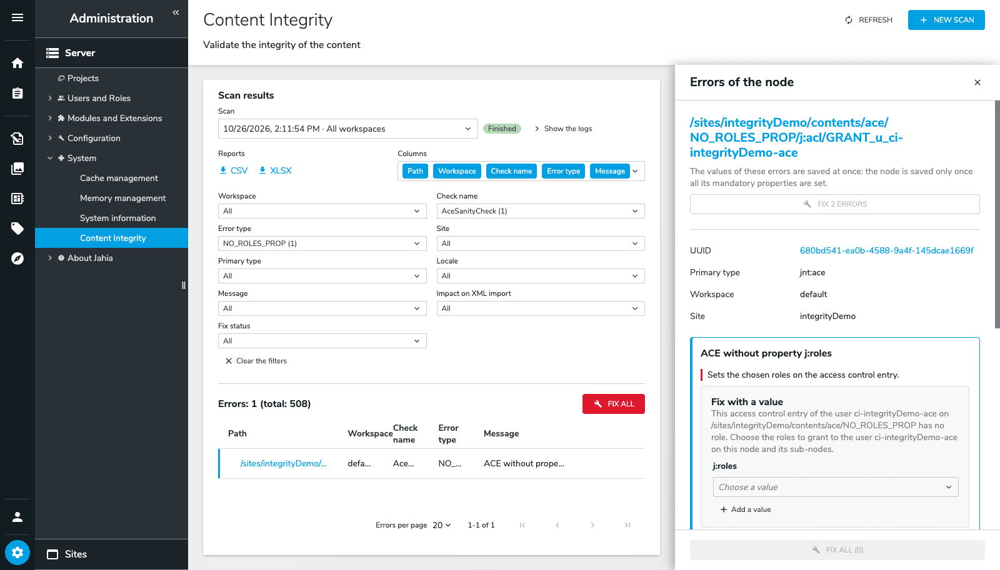

**Description**: the entry, regular or external, has no property `j:roles`. It grants or denies nothing.

**Fix**: in the details of the error, in the administration screen, choose the roles in dropdowns, then click **Fix**. The roles offered are the ones which can be given at the place of the entry: on content, the roles of the groups `edit-role` and `live-role`, on a site node the roles of the group `site-role` too, and out of the sites the roles of every group. The hidden roles are not offered. The details tell to which principal the roles are granted, or denied, and on which node. The entry is saved with the listeners enabled. The right roles can't be guessed, so **Fix all** skips this error, and the command `jcr:integrity-fix`, which provides no value, does not fix it.

When the principal is missing as well, both values are chosen, and saved at once.

#### Role which does not exist

`Error code: ROLE_DOESNT_EXIST`

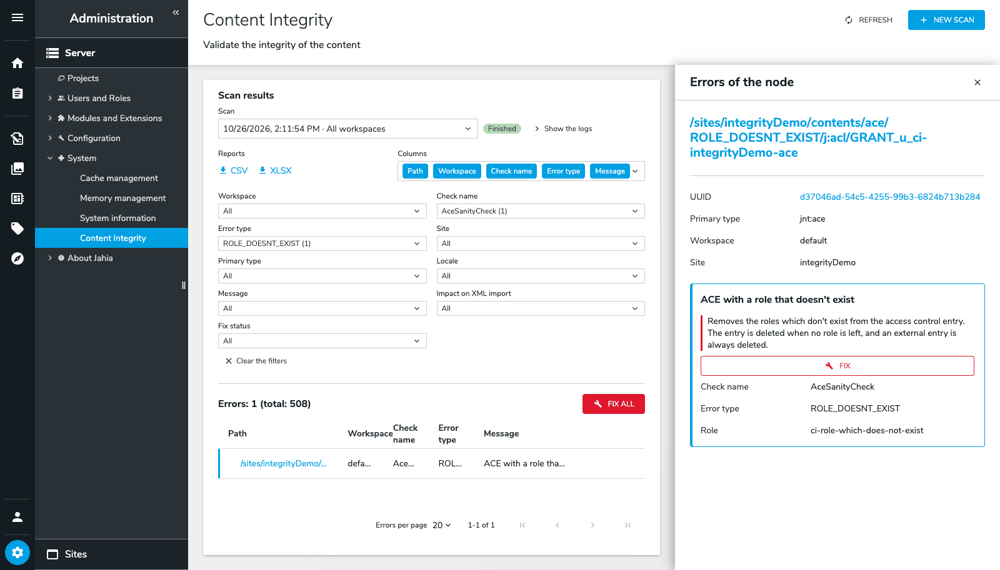

**Description**: the entry names in `j:roles` a role which does not exist under `/roles`. On a regular entry, an error is raised for each role which does not exist. On an external entry, the error is raised when its role does not exist. The details tell the role.

The role has usually been deleted, or was provided by a module which is not deployed anymore. If the role is still needed, create it again, or deploy its module again: the error disappears on the next scan.

**Fix**: removes the roles which don't exist from the access control entry. The entry is deleted when no role is left, and an external entry is always deleted. A role created again since the scan is kept. A regular entry is saved with the listeners enabled, and its access control list is published again in the `default` workspace, as for `NO_ACE_TYPE_PROP`.

#### Missing member in the site privileged group

`Error code: MISSING_SITE_PRIVILEGED_GRP_MEMBER`

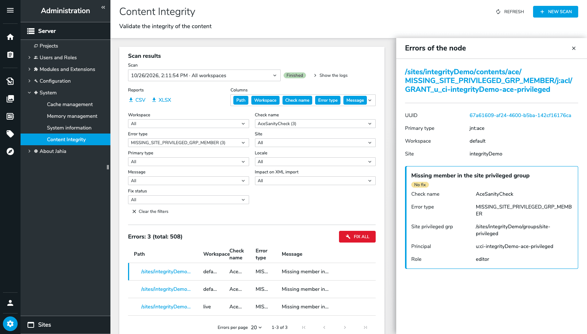

**Description**: the entry names a role with a privileged access (`j:privilegedAccess`), such as `editor`, but its principal is not a member of the group `site-privileged` of the site of the entry. The details tell the group, the principal and the role.  
The error is not raised when the group `site-privileged` of the site does not exist (see [SiteLevelSystemGroupsCheck](#sitelevelsystemgroupscheck)), nor when the principal is invalid (see `INVALID_PRINCIPAL`). The type of the entry is not considered: an entry which denies such a role raises the error as well, which can then be ignored.

When such a role is granted, the ACL listener adds the principal to the group `site-privileged`, which gives access to the editing interfaces of the site. Without this membership, the principal can't reach the content it is granted to edit.

To restore it, add the principal to the members of the group `site-privileged` of the site, or remove the role from the principal and grant it again from the UI.

**Fix**: no automatic fix: the membership has to be restored by hand.

#### Missing external entry

`Error code: MISSING_EXTERNAL_ACE`

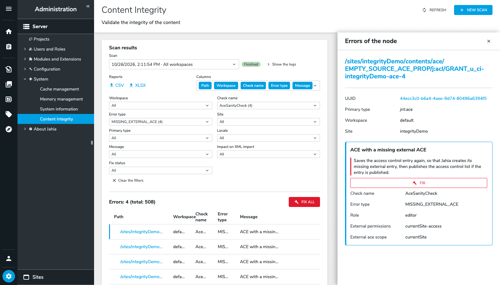

**Description**: the regular entry, of type `GRANT`, names a role which declares external permissions, but no external entry references it for these external permissions. The principal does not get the permissions the role gives out of the node, such as the access to the site. The details tell the role, the external permissions and where they apply.

**Fix**: saves the access control entry again, so that Jahia creates its missing external entry, then publishes the access control list if the entry is published. Not fixed when an external entry already sits at the expected place for other external permissions, for example when its `j:externalPermissionsName` was changed (see `INVALID_EXTERNAL_PERMISSIONS`): the ACL listener keeps it and creates no other one, and the entry is not published.

#### Entry not of type GRANT with an external entry

`Error code: ACE_NON_GRANT_WITH_EXTERNAL_ACE`


**Description**: the regular entry is not of type `GRANT` (`DENY`, or no type), but an external entry references it as its source. An error is raised for each external entry. The details tell the type and the roles of the entry, and the path of the external entry.

This usually happens when the type of an entry is changed without the listeners. The external entry is then reported with `SOURCE_ACE_NOT_TYPE_GRANT` (when the entry has a type).

**Fix**: no automatic fix on the entry itself. Fix the error `SOURCE_ACE_NOT_TYPE_GRANT` of the external entry: it removes this entry from the sources of the external entry, which clears both errors.

#### External entry without source

`Error code: NO_SOURCE_ACE_PROP`

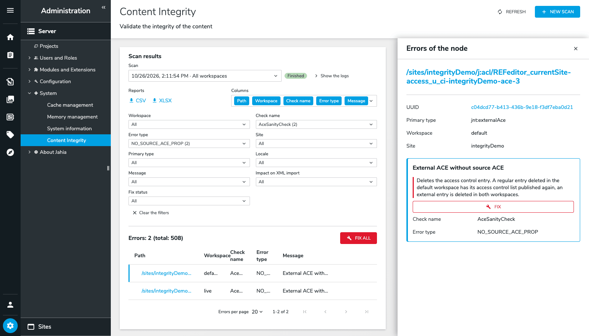

**Description**: the external entry has no property `j:sourceAce`.

`Error code: EMPTY_SOURCE_ACE_PROP`

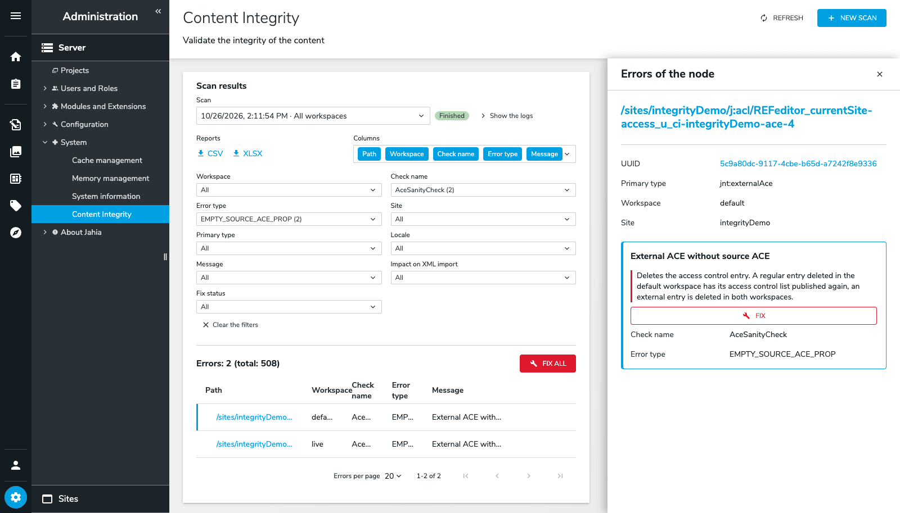

**Description**: the external entry has a property `j:sourceAce` with no value.

Such an external entry gives permissions which no entry grants anymore.

**Fix**: deletes the external access control entry, from both workspaces. An ACL left empty is deleted.

#### Broken reference to a source entry

`Error code: SOURCE_ACE_BROKEN_REF`

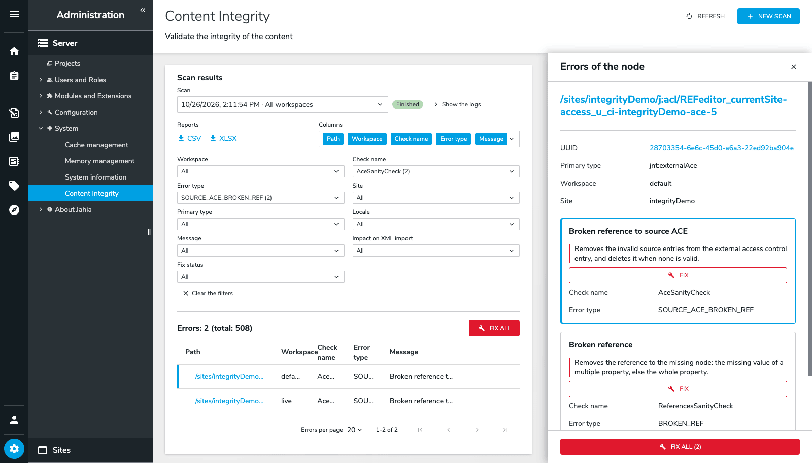

**Description**: a value of `j:sourceAce` references an entry which does not exist. In the `live` workspace, the error is not raised when the source entry exists in the `default` workspace, since it can be not published yet. An error is raised for each broken value.

#### Source entry not of type GRANT

`Error code: SOURCE_ACE_NOT_TYPE_GRANT`

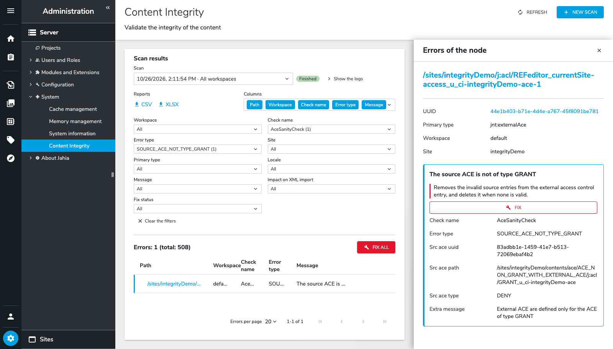

**Description**: a source entry of the external entry is not of type `GRANT`. External entries are written only for the entries of type `GRANT`. The details tell the identifier, the path and the type of the source entry.

#### Roles which differ from the source entry

`Error code: ROLES_DIFFER_ON_SOURCE_ACE`

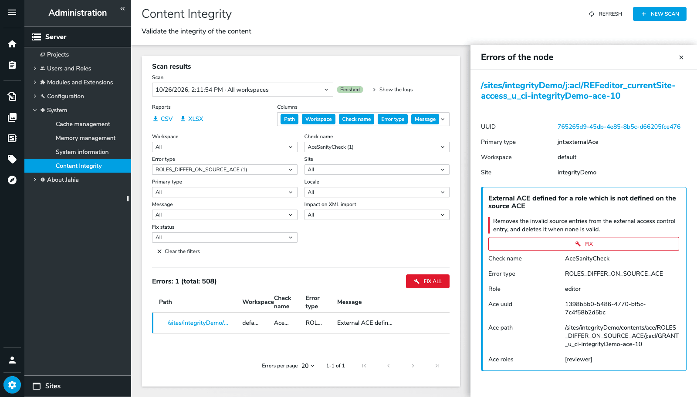

**Description**: the role of the external entry is not one of the roles of its source entry, for example because the roles of the source entry were changed without the listeners. The details tell the role, and the source entry with its roles.  
The error is raised as well, with another message, when the source entry has no `j:roles`: the consistency of the roles can't be checked then.

#### External entry at an invalid location

`Error code: INVALID_EXTERNAL_ACE_PATH`

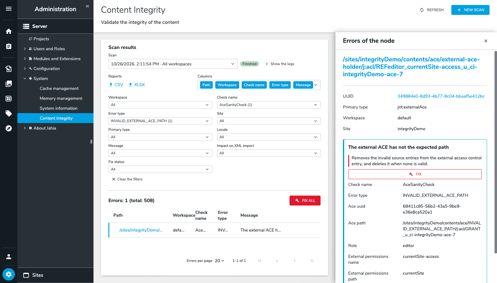

**Description**: the external entry is not where its external permissions apply. The expected path is the `j:path` of the external permissions of the role, `currentSite` being replaced with the path of the site of the source entry, followed by `/j:acl/<name of the external entry>`. The details tell the source entry, the role, the external permissions, their path, and the expected path of the external entry.

**Fix** (`SOURCE_ACE_BROKEN_REF`, `SOURCE_ACE_NOT_TYPE_GRANT`, `ROLES_DIFFER_ON_SOURCE_ACE`, `INVALID_EXTERNAL_ACE_PATH`): removes the invalid source entries from the external access control entry, and deletes it when none is valid. A source is invalid when it can't be resolved, when it is not of type `GRANT`, or when the role or the location of the external entry do not match it. `j:sourceAce` is rewritten with the listeners disabled. When the source entry has no `j:roles`, the error `ROLES_DIFFER_ON_SOURCE_ACE` is not fixed: fix `NO_ROLES_PROP` on the source entry first.  
A source entry removed this way may be left without its external entry: run a new scan, it is then reported with `MISSING_EXTERNAL_ACE`, whose fix creates the external entry at the expected place.

#### Invalid roles on an external entry

`Error code: INVALID_ROLES_PROP`


**Description**: the `j:roles` of the external entry has no value, or several values, while an external entry is written for a single role. The details tell the roles found. The roles of the external entry are checked against each of its source entries which has some `j:roles`.

**Fix**: deletes the external access control entry, then saves its source entries again, so that Jahia creates the right external entries, one per role. The access control list of a source entry is published when the source entry exists in `live`.

#### External permissions not declared by the role

`Error code: INVALID_EXTERNAL_PERMISSIONS`

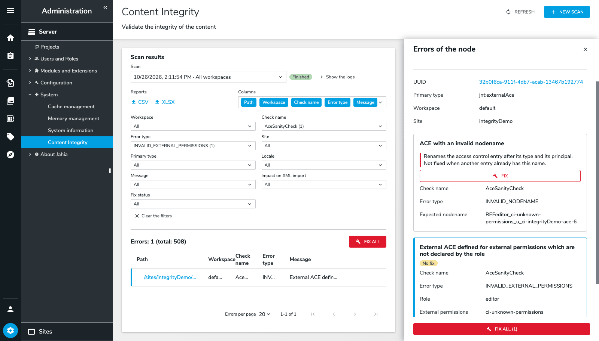

**Description**: the external permissions named by the external entry (`j:externalPermissionsName`) are not declared by its role, nor by its parent roles. The details tell the role, the external permissions of the external entry, and the ones the role declares.

The external permissions have usually been removed from the role, or renamed. If they are still needed, restore them in the definition of the role. Otherwise, the external entry is useless, and can be deleted with a script, with the listeners disabled, in each workspace.

**Fix**: no automatic fix: this error needs an analysis.

#### Duplicated reference to a source entry

`Error code: DUPLICATED_REF_SRC_ACE`

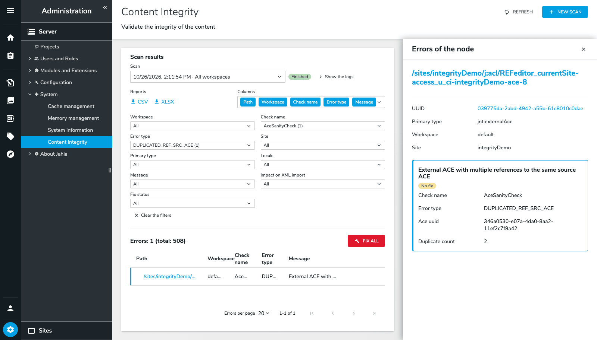

**Description**: the `j:sourceAce` of the external entry references the same source entry several times. The details tell the identifier of the source entry and the number of references.

The duplicated values can be removed with a script, run with the listeners disabled, in each workspace:

```
import org.jahia.services.content.JCRObservationManager

def session = org.jahia.services.content.JCRSessionFactory.getInstance()
                  .getCurrentSystemSession("default", null, null)
def externalAce = session.getNode("/sites/mySite/j:acl/REFeditor_currentSite-access_u_john")
def values = externalAce.getProperty("j:sourceAce").getValues().toList().unique { it.getString() }
JCRObservationManager.setAllEventListenersDisabled(true)
try {
    externalAce.setProperty("j:sourceAce", values as javax.jcr.Value[])
    session.save()
} finally {
    JCRObservationManager.setAllEventListenersDisabled(false)
}
```

**Fix**: no automatic fix.

#### Too many access control entries

`Error code: TOO_MANY_ACE`

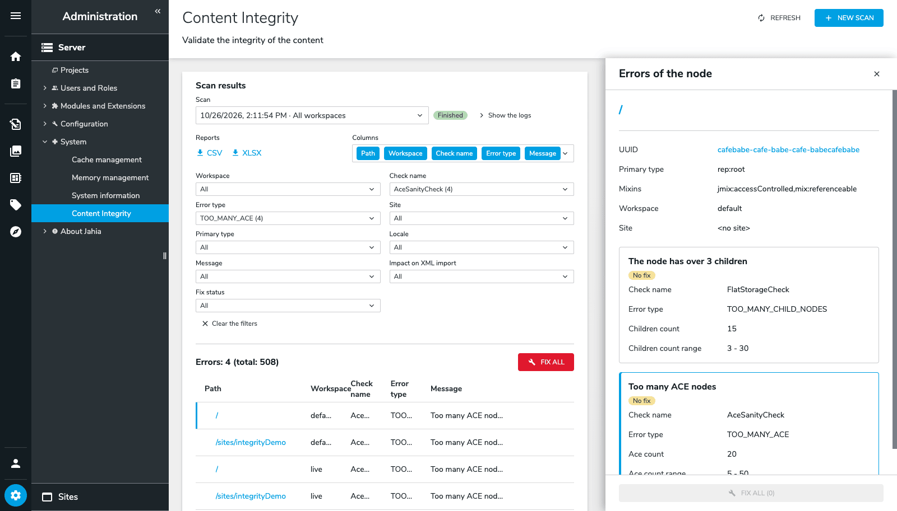

**Description**: the number of access control entries of a site, regular and external ones, reaches the threshold of the check (`ace-count-threshold`). The error is raised on the site node at the end of the scan, or on the root node for the entries out of the sites. Only the entries of the scanned subtree and workspace are counted. The details tell the number of entries.

A large number of entries impacts the performance of the permissions checks. Review the way the permissions are given on the site: grant the roles to groups rather than to individual users, and on the upper levels of the tree rather than node by node.

**Fix**: no automatic fix: the permissions of the site have to be reviewed.

## BinaryPropertiesSanityCheck

Detects the properties of type `binary` for which the value can't be loaded.

The check is enabled by default and runs on every node, in the `default` and the `live` workspaces. By default, only the length of each binary is read, and a binary of zero byte is reported as invalid: an empty file uploaded on purpose is then reported as well, with a warning telling that it can be a false positive.

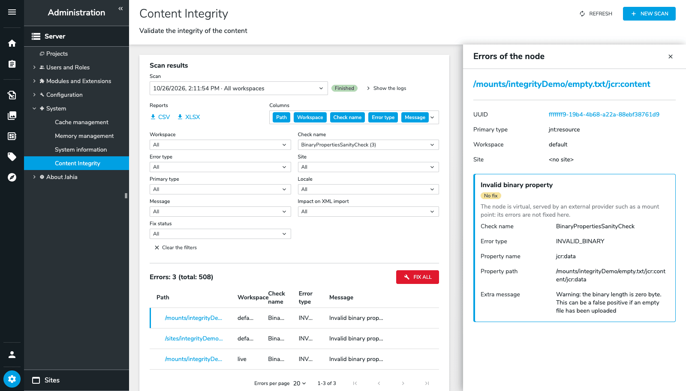

### Configuration

| Name                      |  Type   | Default Value | Description                                                                                                                                                                               |
|---------------------------|:-------:|:-------------:|-------------------------------------------------------------------------------------------------------------------------------------------------------------------------------------------|
| download-stream           | boolean |     false     | If `true`, each binary property is validated by reading its value as a stream (time consuming operation). Otherwise, only the length of the binary is read                                |
| accept-zero-byte-binaries | boolean |     false     | If `true`, the binary properties with a valid zero byte length value will not be reported as errors. Otherwise, the binary is considered as valid only if its length is greater than zero |

### Dealing with errors

#### Invalid binary property

`Error code: INVALID_BINARY`

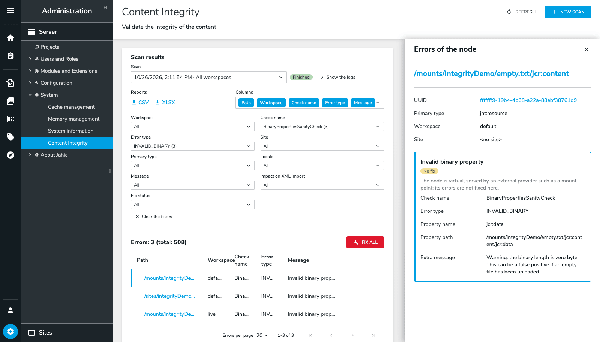

**Description**: a property of type `binary` has an invalid value. Without `download-stream`, the binary is invalid when its length is not greater than zero, or, when `accept-zero-byte-binaries` is `true`, when its length is negative (unknown). With `download-stream`, the binary is invalid when its stream can't be read, or when the number of bytes read differs from its declared length; a zero byte binary is still reported unless `accept-zero-byte-binaries` is `true`. The details of the error tell the name and the path of the property. When the property is held by a translation node, the error is reported for the language of this node. When the length of the binary is zero, a warning tells that the error can be a false positive, if an empty file has been uploaded.

If the number of errors is limited, it should be analyzed on a node by node basis.  
Usually, the missing binary will be the value of the `jcr:data` property of the `jcr:content` sub-node of a `jnt:file` node. In such case, you should first make the users aware of the issue, since they might be able to re-upload the file or accept to delete the whole file node.

If the number of errors is important, then it is probably the consequence of an inappropriate system operation. Then, a generic solution should be evaluated.  
Since the binary data can be store either in the database or on the filesystem (choice done at Jahia installation time), the way to deal with the errors differs depending on the type of storage.

**Fix**: deletes the file whose binary is missing, or the node which holds the binary property. On a translation node, only the property is removed, so that the other languages are kept. When the property is held by the `jcr:content` sub-node of a file, the whole file node is deleted. The deletion is done with the listeners disabled, in the workspace where the error is reported. This can't be undone: restore the binary from a backup instead if it matters, as explained below. **Fix all** applies this fix as well.

#### Database storage

With this storage type, there is no possibility to fix the issue directly in the database. If the binaries are missing as a consequence of a recent operation, then the Jahia environment should be restored from a backup taken before the faulty operation. If you are not sure of the time of the operation, and need to confirm that the backup to be restored will solve the issue, the only solution is to restore this backup on another environment and run an integrity check there.  

If restoring the production from a backup is not an option, then you can restore the backup on another server and extract the missing binaries from this environment to fix the data on production. For nodes of type `jnt:file`, the files can be downloaded from this environment and re-uploaded on production. To avoid breaking references to the files, do not delete/recreate the file. You can upload a new binary on an existing file node.  
If the production is clustered, this temporary environment can be simply restored as a standalone environment. 

#### Filesystem storage 

With this storage type, the errors can be the consequence of an incorrect manipulation on the filesystem in the `datastore` folder.  
It can also be faced when restoring a backup, if the backup was taken while Jahia was running, and the `full readonly mode` not enabled. The issue happens when a file is uploaded while the backup is taken, if the `datastore` folder is already saved at the time the file is uploaded, but the file node declaration written in the database is part of the database dump.

Since each binary property value is saved as a unique file in the `datastore` folder, the issue can be easily fixed by restoring the missing file, with the correct name and path. You can recover the missing files from a backup of the `datastore` folder and copy them onto the production filesystem. A binary file can be referenced by several properties, so the number of missing files can be lower than the number of errors.  
If the number of errors is important, you can also merge the `datastore` folder from your backup into the one of your production environment. Doing so, you might restore some useless binaries as well (e.g. referenced by no property). If you proceed that way, you can then run the `Datastore garbage collector` in the tools, to detect and purge those orphan binaries.

## ChildNodeDefinitionsSanityCheck

Detects the nodes which are not allowed by the definition of their parent node.

The check is enabled by default and runs on every node except the root node, in the `default` and the `live` workspaces. A node is reported when none of its types, primary type or mixins, is accepted by a child node definition of its parent for its name. A translation node (`jnt:translation`) is never reported when its parent is of type `jmix:i18n`: Jahia adds this mixin to any type which declares an internationalized property, so that it accepts translation sub-nodes no matter the definition.

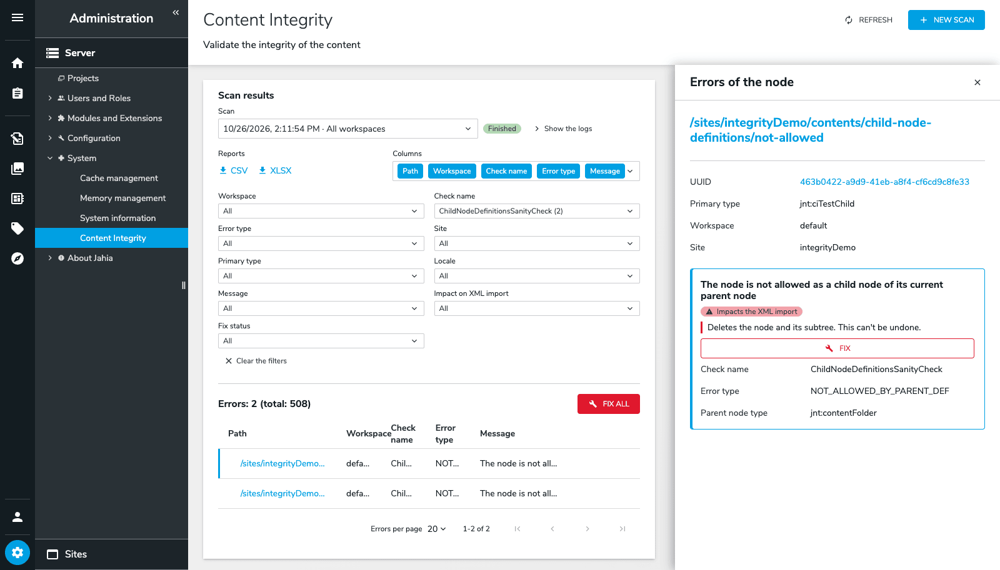

### Dealing with errors

#### Node not allowed by its parent

`Error code: NOT_ALLOWED_BY_PARENT_DEF`


**Description**: the parent node has no child node definition which accepts the node, with its name and any of its types. The details of the error tell the primary type of the parent node.

Usually, such issue appears after a modification of some definitions. If the name of the child node has been modified in the definitions, then the related nodes should be renamed accordingly in the JCR.

If the child node is of a type that is not allowed anymore by its parent, then such node should be deleted or moved to a new parent.

**Fix**: deletes the node and its subtree. The node is removed at the Jackrabbit level, since the regular API can't load its definition, with the listeners disabled, in the workspace where the error is reported. This can't be undone: if the content has to be kept, rename or move the node instead, as explained above. **Fix all** applies this fix as well.

## FlatStorageCheck

Detects the nodes having too many direct sub-nodes (500 by default, can be configured).   
The JCR is not designed to handle flat storage, and such structure has an impact on the performance.

The check is enabled by default and runs on every node, in the `default` and the `live` workspaces.


### Configuration

| Name      |       Type        | Default Value  | Description                                              |
|-----------|:-----------------:|:--------------:|----------------------------------------------------------|
| threshold | positive integer  |      500       | Number of children nodes beyond which an error is raised |

### Dealing with errors

#### Too many child nodes

`Error code: TOO_MANY_CHILD_NODES`

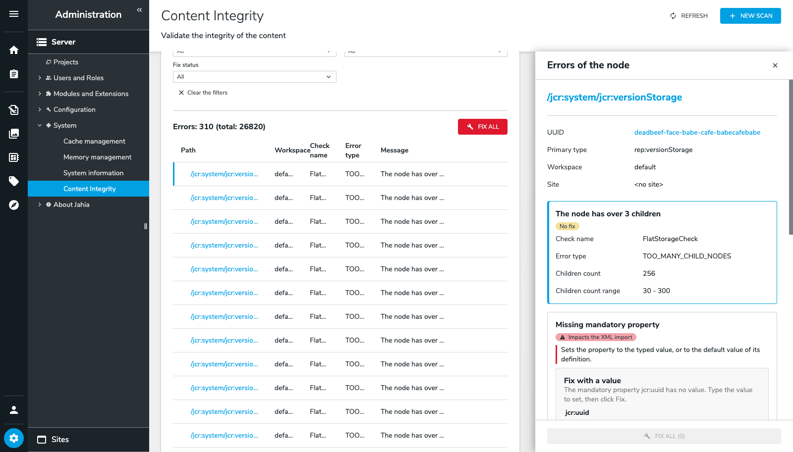

**Description**: the node has strictly more direct sub-nodes than the configured `threshold`. The details of the error tell the number of sub-nodes, and an approximate range of this number, which allows to group the errors of similar nodes.

You need to refactor your data model, usually splitting those nodes into some subtrees. One possible solution involves the Jahia built-in [auto split feature](https://academy.jahia.com/documentation/developer/jahia/8/working-with-our-apis/manipulating-content-with-apis/using-the-jcr-api#autosplitting-nodes).

If the problem is related to regular nodes (as opposed to UGC), then it has to be fixed in the `default` workspace and then propagated to the `live` workspace through publication.

**Fix**: no automatic fix: the right structure depends on the data model, and moving the sub-nodes would change their path. **Fix all** skips this error.

## HomePageDeclarationCheck

Each site must have a unique home page node.  
The home page node is a node of type `jnt:page`, with a boolean property named `j:isHomePage` having `true` as a value, and is a direct child node of the site node. If there's no node matching those conditions, but the site has a direct child node of type `jnt:page` named `home`, then this one will be used as the home page of the site.  

The check is enabled by default and runs on the site nodes (`jnt:virtualsite`) under `/sites`, in the `default` and the `live` workspaces. In the `live` workspace, a site without a flagged home page is not reported when it has a page named `home`, or when it has no page named `home` at all: the error is reported in `default`, and the home page may simply not be published yet.

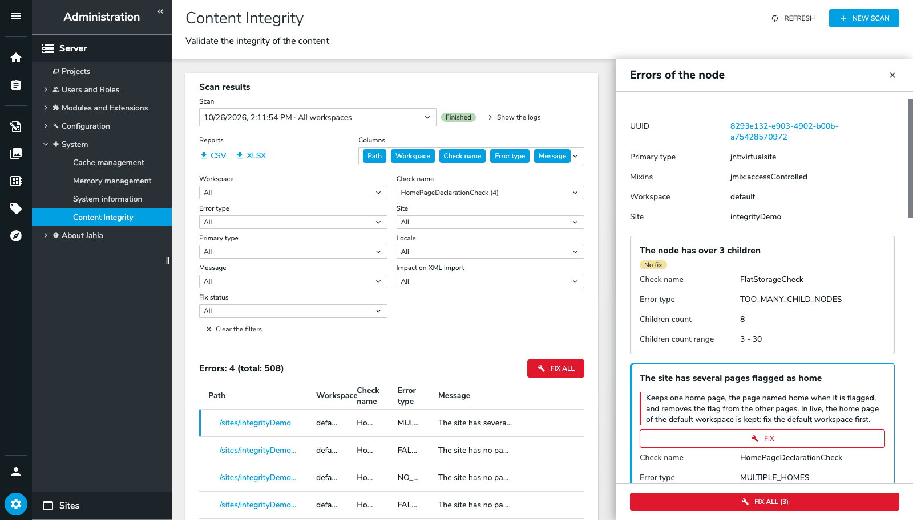

### Dealing with errors

Since the home page is usually defined by the template set, you should also review this one, all the more if you see the error appear again every time you create a new site. 

#### No home page

`Error code: NO_HOME`

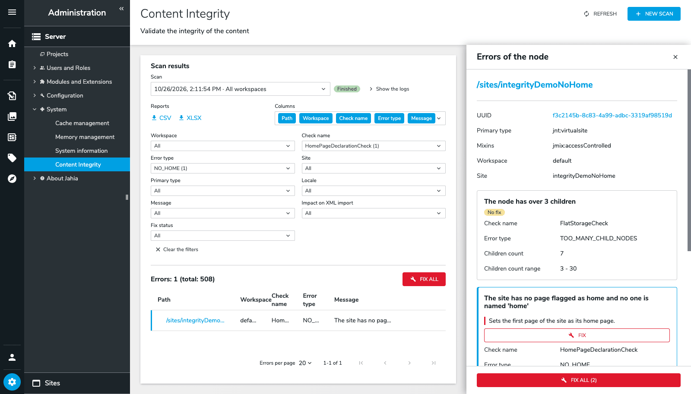

**Description**: no direct child page of the site is flagged with `j:isHomePage`, and the site has no direct child node named `home`. Reported in the `default` workspace only.

You need to decide which page has to be used as the home page. Then, simply open the `repository explorer`, activate the display of the hidden properties, and check the option `j:isHomePage` on your desired home page.  
The page node should be republished to propagate the fix to the `live` workspace. 

The issue can have been introduced by moving the home page under another one, so that it is not anymore a direct child of the site node. You can check that by running the below SQL-2 query. If a page is identified, you need to decide if you prefer moving it back under the site, or if you prefer to keep this page at its current location. In such case, you should uncheck the property `j:isHomePage`

    select * from [jnt:page] where isdescendantnode('/sites/mysite') and [j:isHomePage]='true'

**Fix**: sets the first page of the site as its home page: `j:isHomePage` is set to `true` on the first direct child node of type `jnt:page`, in the order of the sub-nodes of the site. The fix fails when the site has no direct child page. Check that this page is the expected one, and republish it to propagate the fix to the `live` workspace.

#### Multiple home pages

`Error code: MULTIPLE_HOMES`

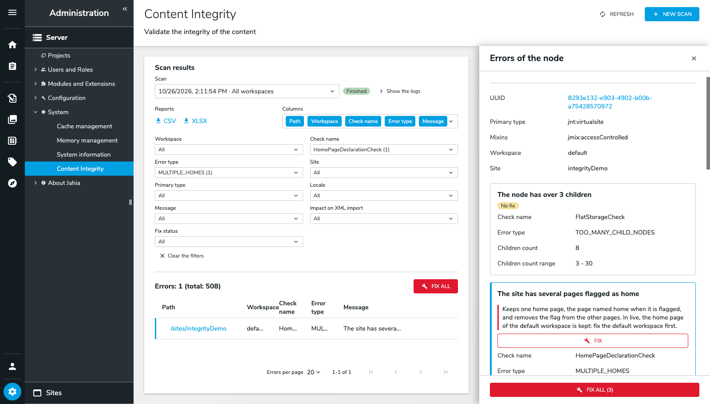

**Description**: several direct child pages of the site are flagged with `j:isHomePage`. Reported in the `default` and the `live` workspaces. The details of the error tell the names of the flagged pages, and their number.

You need to decide which page has to be used as the home page. Then, simply open the `repository explorer`, activate the display of the hidden properties, and uncheck the option `j:isHomePage` on every page wrongly flagged as the home page.  
Every updated page node should be republished to propagate the fix to the `live` workspace.

**Fix**: keeps one home page, the page named `home` when it is flagged, otherwise the first flagged page in the order of the sub-nodes of the site, and removes the flag from the other pages. In `live`, the home page of the `default` workspace is kept: fix the `default` workspace first. The fix fails in `live` while the `default` workspace has no flagged home page, or several. If the home page of `default` is not published yet, the flag is removed from every page in `live`.

#### Fallback on the page named `home`

`Error code: FALLBACK_ON_NAME`


**Description**: no direct child page of the site is flagged with `j:isHomePage`, but the site has a direct child page named `home`, which is used as the home page. Reported in the `default` workspace only.

It is preferable to explicitly flag the home page as such. Simply open the `repository explorer`, activate the display of the hidden properties, and check the option `j:isHomePage` on your home page.  
The page node should be republished to propagate the fix to the `live` workspace.

If no page is flagged as home, but a direct sub-node of the site node is named `home`, then it is critical to flag a page as the home.

**Fix**: flags the page named `home` as the home page of the site, setting `j:isHomePage` to `true`. Republish the page to propagate the fix to the `live` workspace.

#### Sub-node named `home` which is not a page

`Error code: FALLBACK_ON_NAME_WRONG_TYPE`

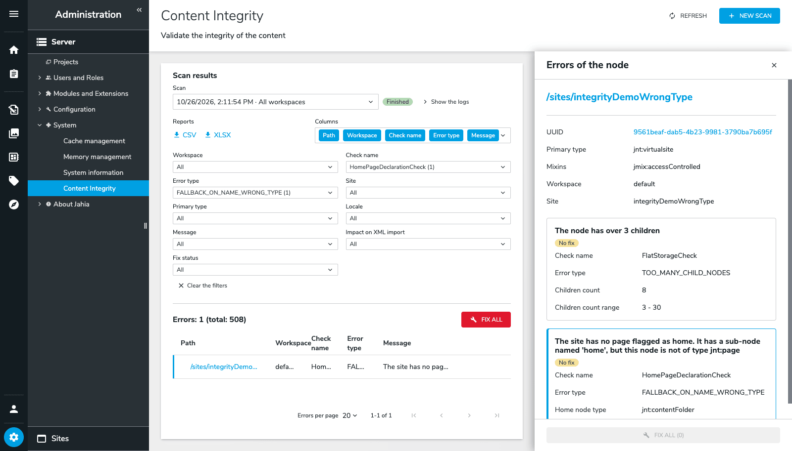

**Description**: no direct child page of the site is flagged with `j:isHomePage`, and the direct child node of the site named `home` is not of type `jnt:page`, so that the site has no usable home page. Reported in the `default` and the `live` workspaces. The details of the error tell the primary type of the node named `home`.

Analyze the node named `home`: it can be some content wrongly created under the site, or a page whose type has been changed. Then, flag the expected page as the home page, as explained for the error `NO_HOME`, and rename, move or delete the node named `home` if it is not expected there.

**Fix**: no automatic fix: the node named `home` needs to be analyzed. **Fix all** skips this error.

## JCRLanguagePropertyCheck

Translation nodes (nodes of type `jnt:translation`) are named after a naming convention. The node must be named `j:translation_xx`, where `xx` is the language code. The node also holds a property named `jcr:language`, which has the language code as a value.  
The language code must be the same in the node name and the value of the property.

Example of valid translation node:

    Name: j:translation_en
    Path: /sites/digitall/home/about/area-main/rich-text/j:translation_en
    Type: jnt:translation
        
    Properties: 
        jcr:language:  en
        jcr:primaryType:  jnt:translation

The check is enabled by default and runs on the translation nodes, in the `default` and the `live` workspaces. The errors are reported for the language read from the name of the translation node.

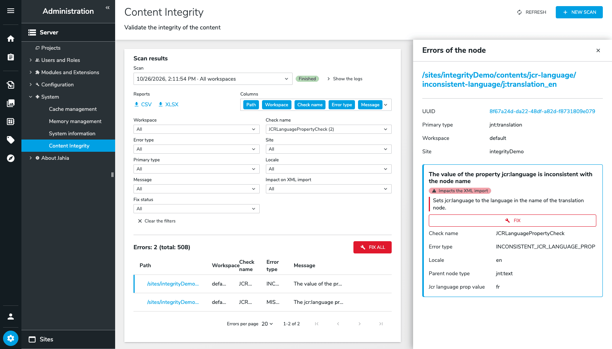

### Dealing with errors

Errors are usually located under `/modules`, in a node being part of a template. The root cause is usually an uncontrolled copy/paste in the `repository.xml` file. In such case, just fix the issue in the XML file, and redeploy the module.

Otherwise, you will need to fix the node in the JCR, updating the property value to match the node name.  
If the impacted nodes are automatically created, for example from some custom java code, it is important as well to identify & fix the faulty code, in order to avoid reintroducing the issue.

#### Missing `jcr:language` property

`Error code: MISSING_JCR_LANGUAGE_PROP`

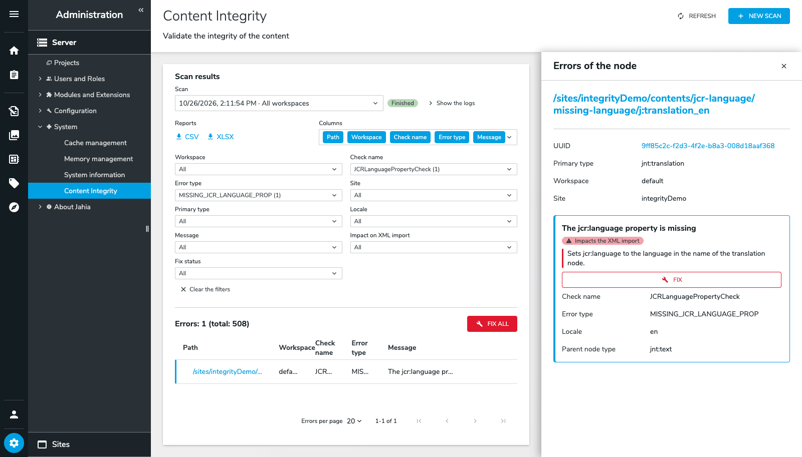

**Description**: translation node without the `jcr:language` property. The details of the error tell the primary type of the parent node.

This one needs to be defined, and its value can usually be deducted from the node name.

**Fix**: sets `jcr:language` to the language in the name of the translation node. The property is written with the listeners disabled, in the workspace where the error is reported. The fix fails when no language can be read from the node name.

#### Inconsistent `jcr:language` property

`Error code: INCONSISTENT_JCR_LANGUAGE_PROP`

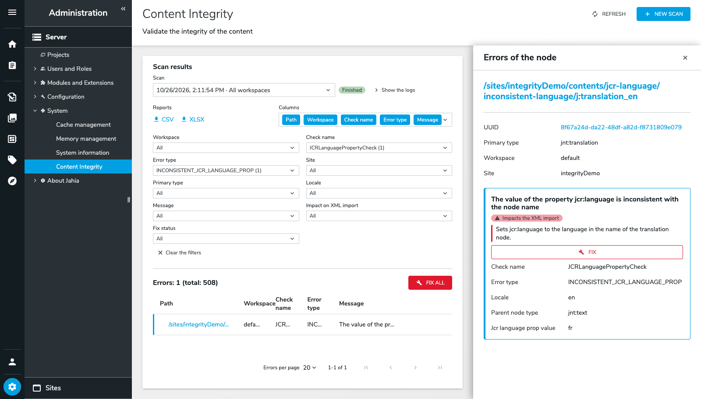

**Description**: translation node with a `jcr:language` property which is not compliant with the node name: the node is not named `j:translation_` followed by the value of the property. The details of the error tell the primary type of the parent node and the value of `jcr:language`.

Usually, the property has to be modified accordingly to the node name. 

**Fix**: sets `jcr:language` to the language in the name of the translation node. The property is written with the listeners disabled, in the workspace where the error is reported. The fix fails when no language can be read from the node name.

## LivePropertiesCheck

Tracks the nodes flagged with the mixin `jmix:liveProperties`, in the `default` and the `live` workspaces.

This check is disabled by default, since `jmix:liveProperties` can be used on purpose.

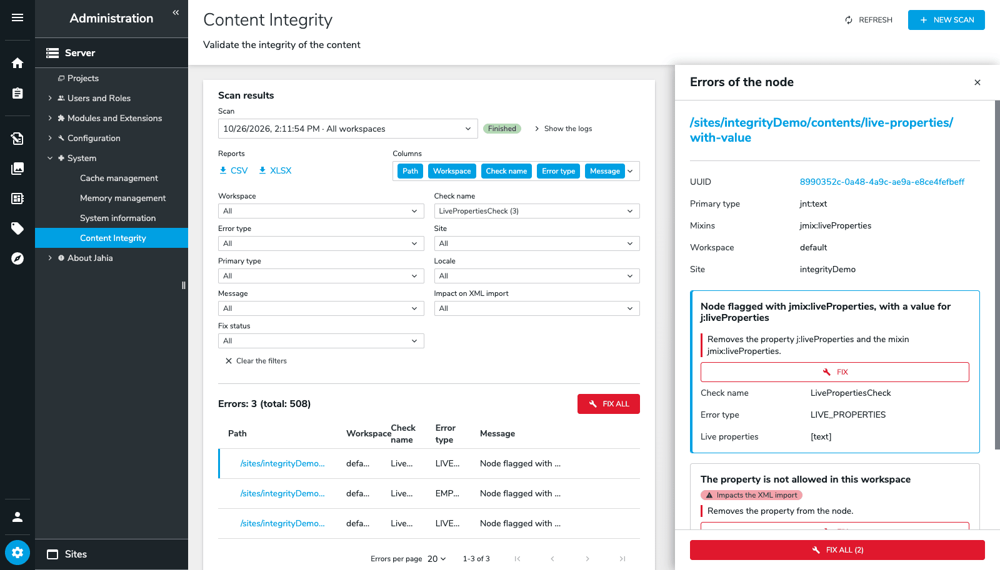

### Dealing with errors

#### Live properties defined on the node

`Error code: LIVE_PROPERTIES`


**Description**: the node is flagged with `jmix:liveProperties`, and the property `j:liveProperties` lists some properties. The details of the error tell the listed properties.

**Fix**: removes the property `j:liveProperties` and the mixin `jmix:liveProperties`, with the listeners disabled, in the workspace where the error is reported.

#### Live properties mixin without any property

`Error code: EMPTY_LIVE_PROPERTIES`

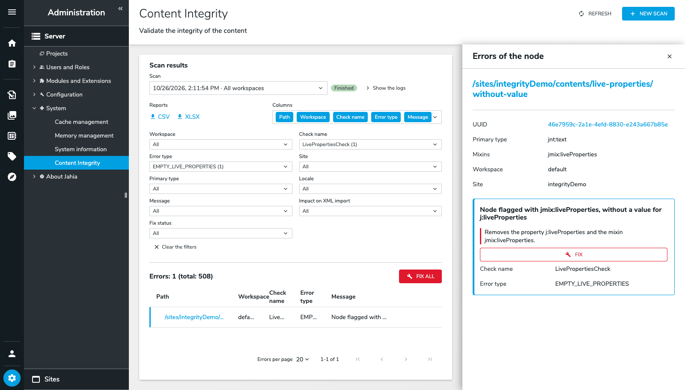

**Description**: the node is flagged with `jmix:liveProperties`, but the property `j:liveProperties` is missing or has no value.

**Fix**: removes the property `j:liveProperties` and the mixin `jmix:liveProperties`, with the listeners disabled, in the workspace where the error is reported.

Both errors can be fixed with the command `jcr:integrity-fix`, which deletes the property `j:liveProperties` and the mixin `jmix:liveProperties`.

## LockSanityCheck

Detects the inconsistencies related to the JCR locks.

The check is enabled by default and runs on the nodes having at least one of the lock properties `j:lockTypes`, `j:locktoken`, `jcr:lockIsDeep` or `jcr:lockOwner`, in the `default` and the `live` workspaces. In the `live` workspace, a node without `jcr:lockOwner` is not locked, and is only checked for the error `LOCK_PROPERTIES_IN_LIVE`. The locks of the workflows are checked in the `default` workspace only.

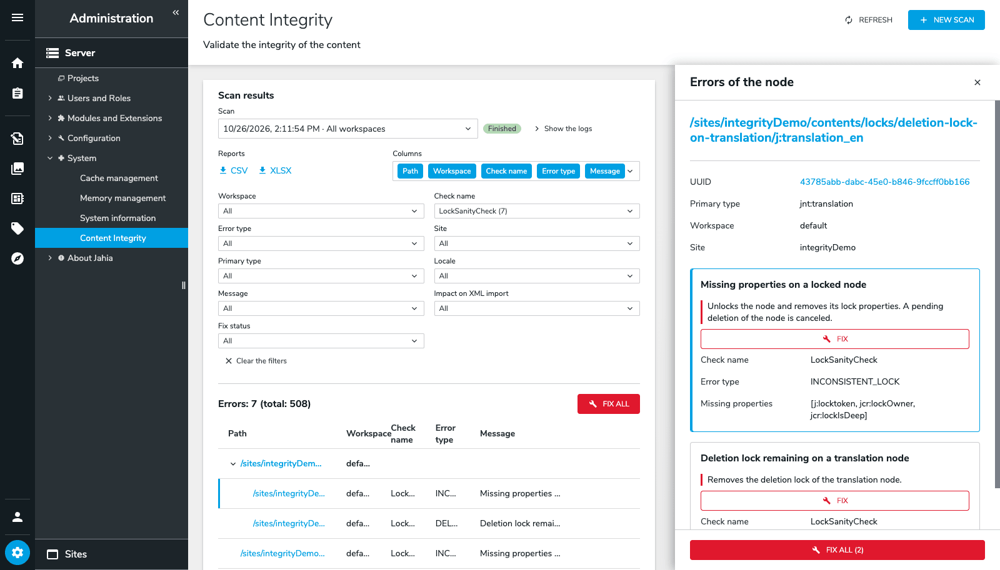

### Dealing with errors

#### Inconsistent lock

`Error code: INCONSISTENT_LOCK`

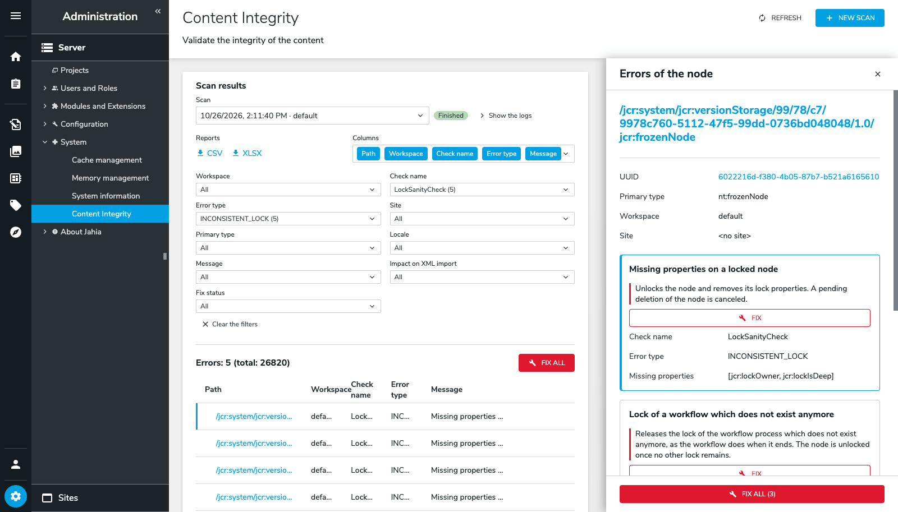

**Description**: when a node is locked, several properties are written on it: `j:lockTypes`, `j:locktoken`, `jcr:lockIsDeep` and `jcr:lockOwner`. When the lock is released, all those properties should be removed.  
A node should have all those properties or none. This error is raised when only some of them are defined; the details of the error tell the missing ones.

First, check in the UI if the node is shown as locked. If it is, try to unlock it. Otherwise, try to lock it and then unlock it. Most of the time, this will be enough to clean the lock related properties on the node.

If the above actions fail, you will need to write a script to clean the node.

**Fix**: unlocks the node and removes its lock properties. A pending deletion of the node is canceled. With the listeners disabled, the node is unmarked for deletion if it is the root of a deletion, then locked and unlocked, so that the platform cleans what it can, then the remaining properties `jcr:lockIsDeep`, `jcr:lockOwner`, `j:lockTypes`, `j:locktoken`, `j:deletionMessage`, `j:deletionDate` and `j:deletionUser` are removed.

#### Remaining deletion lock on a translation node

`Error code: DELETION_LOCK_ON_I18N`


**Description**: when a node is marked for deletion, a lock is set on the node, and its translation sub-nodes as well. If the node is undeleted, all those locks are supposed to be removed.  
This error is raised when a deletion lock is detected on a translation node, but the parent node is not marked for deletion.

To clear this lock, open the page composer in the language of the detected translation node, delete the piece of content, and undelete it. 

**Fix**: removes the deletion lock of the translation node. With the listeners disabled, the translation node is marked and unmarked for deletion, then its remaining lock and deletion properties are removed, as for the error `INCONSISTENT_LOCK`.

#### Lock of a workflow which does not exist anymore

`Error code: LOCK_OF_UNKNOWN_PROCESS`

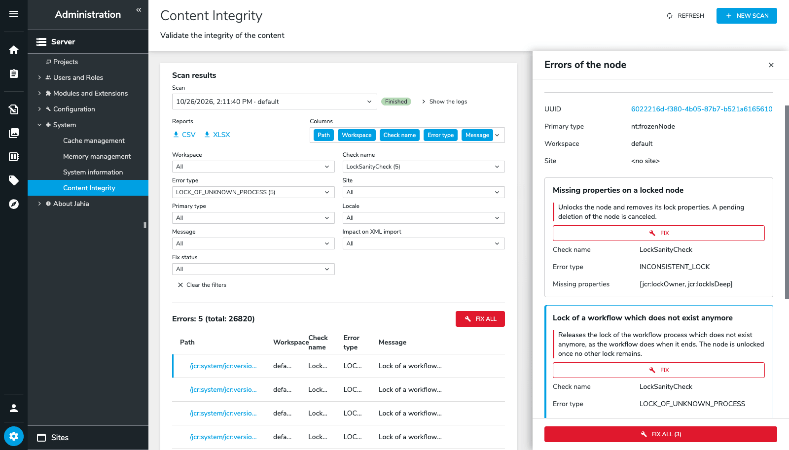

**Description**: a workflow locks its nodes while it runs, and releases them when it ends: the lock type of a publication workflow is
` publication-process-<id> :validation`, the one of the lock step of a workflow definition ` process-<id> :<type>`, `<id>`
being the identifier of its process. A process removed without ending, for example from the tables of jBPM, leaves its
locks: the node can't be edited anymore, and nothing tells that a workflow holds it, since the process doesn't exist.  
This error is raised in the `default` workspace when the process of a lock type is unknown to the workflow service. The details of the error tell the lock type and the identifier of the process. Nothing is reported when the workflow service is not available, or when the process can't be read.

**Fix**: releases the lock of the workflow process which does not exist anymore, as the workflow does when it ends: its lock type is removed, and the node is
unlocked once no other lock remains.

#### Lock properties in the live workspace

`Error code: LOCK_PROPERTIES_IN_LIVE`

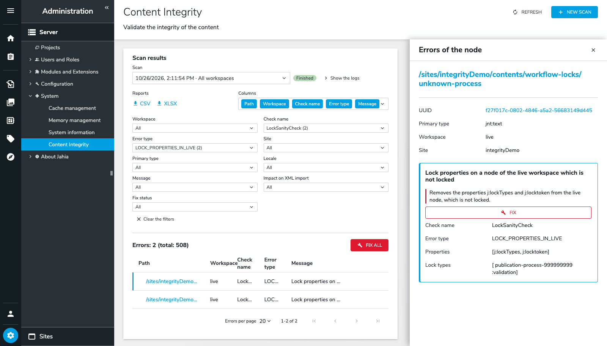

**Description**: a workflow publishes its nodes before it unlocks them. The first publication of a node clones it to the `live` workspace,
with its properties: `j:lockTypes` and `j:locktoken` are copied, but not the JCR lock itself. The lock is then released in
`default` only, and those properties stay in `live`, where the node is not locked.  
This error is raised in the `live` workspace on a node which has `j:lockTypes` or `j:locktoken` without being locked (no `jcr:lockOwner`). The details of the error tell the properties found and the lock types.

**Fix**: removes the properties `j:lockTypes` and `j:locktoken` from the `live` node, which is not locked. The fix fails if the node has been locked since the scan.

## MarkForDeletionCheck

When deleting a piece of content from the UI, the node is not technically deleted from the `default` workspace, but marked for deletion. This results in adding some mixins on the node as well as on its sub-nodes.
* `jmix:markedForDeletionRoot` is added on the node which you have deleted
* `jmix:markedForDeletion` is added on every node in the subtree, including the root node.

A node flagged as deleted, but without deletion root, is inconsistent. From the UI, you can trigger the publication or the undeletion of the tree only on the root node of the deletion. 

The check is enabled by default and runs on the nodes flagged with `jmix:markedForDeletion`, in the `default` and the `live` workspaces.


### Dealing with errors

If a few pieces of content are impacted, you can delete again the root node of the deletion from the UI. This will add back the missing mixins, allowing then to publish or undelete the tree, still from the UI.

If an important number of nodes are impacted, you will need to write a script to clean the mixins on the inconsistent nodes.

The errors can be fixed with the command `jcr:integrity-fix`, which unmarks the nodes for deletion.

#### Deletion without root

`Error code: NO_ROOT_DELETION`

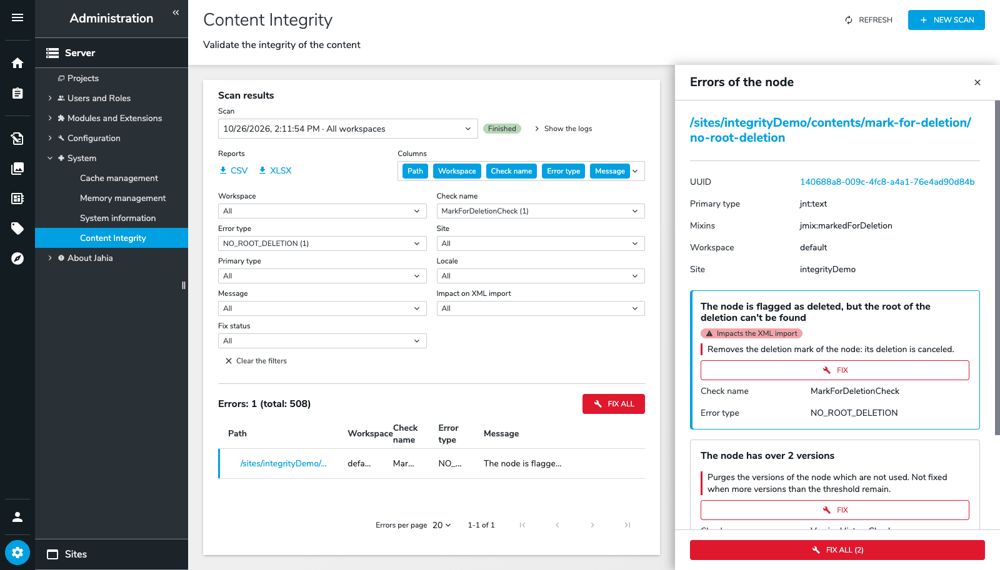

**Description**: in the `default` workspace, outside of `/users`, a node is flagged with `jmix:markedForDeletion` but not with `jmix:markedForDeletionRoot`, and no root of the deletion can be found above it: walking up its ancestors, a node which is not flagged with `jmix:markedForDeletion` is reached before any node flagged with `jmix:markedForDeletionRoot`.

**Fix**: removes the deletion mark of the node: its deletion is canceled. With the listeners disabled, the node is marked for deletion again, which rebuilds a consistent deletion state, then unmarked. If the content has to be deleted, delete it again from the UI and publish the deletion.

#### Deletion mark in the `live` workspace

`Error code: DELETION_MARK_IN_LIVE`

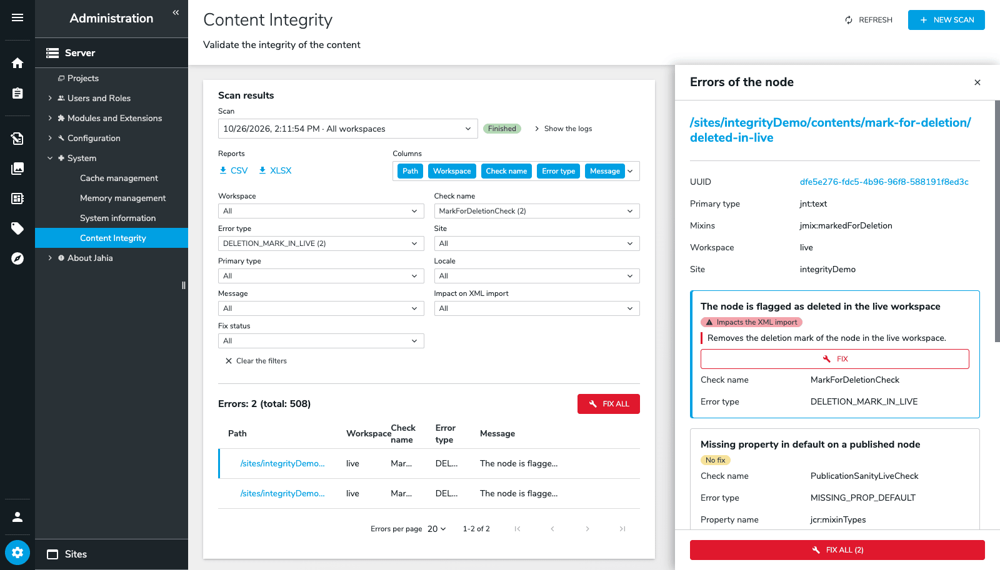

**Description**: a deletion is marked in the `default` workspace, and published as a removal. The mixin `jmix:markedForDeletion` never exists in the `live` workspace. Any node flagged with it in `live` is reported, including under `/users`.

**Fix**: removes the deletion mark of the node in the `live` workspace, marking then unmarking it for deletion with the listeners disabled.

#### Deletion mark under `/users`

`Error code: DELETION_MARK_UNDER_USERS`

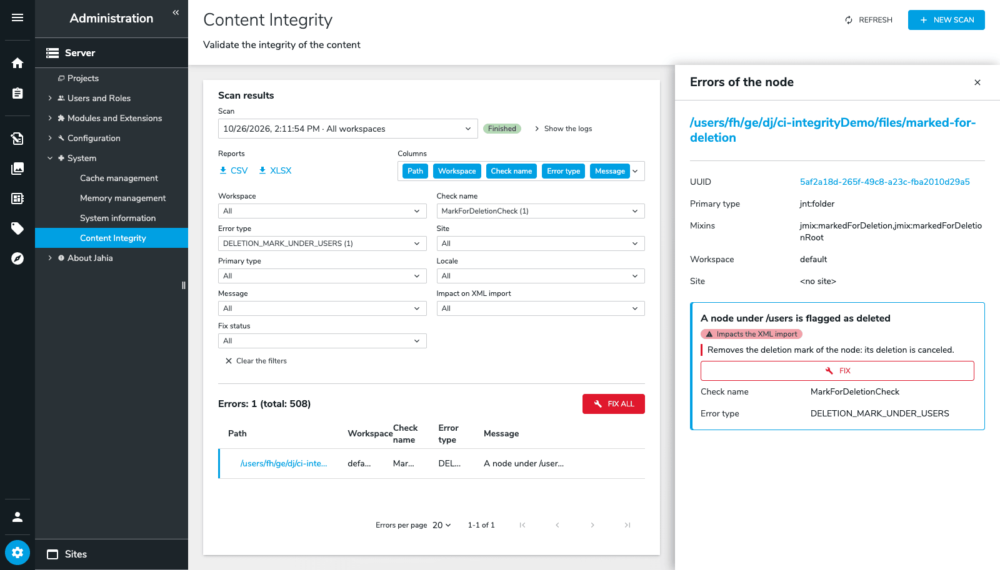

**Description**: the users are auto-published, so no node under `/users` is expected to be marked for deletion, in the `default` or the `live` workspace. This error is raised in the `default` workspace; in `live`, such a node is reported as `DELETION_MARK_IN_LIVE`.

**Fix**: removes the deletion mark of the node: its deletion is canceled. The node is marked then unmarked for deletion, with the listeners disabled.

## NodeNameInfoSanityCheck

Each node has a name and a path. This information is copied to properties on the nodes: `j:nodename` and `j:fullpath`.
Renaming or moving a node, or one of its parents updates one or both properties. They are supposed to be automatically synchronized.

The property `j:fullpath` is deprecated and will be removed from Jahia in a future version. It might be missing,
but when it is defined, it must hold the path of the node.

This check is disabled by default. Once enabled, it runs on the nodes of type `jmix:nodenameInfo`, in the `default` and the `live` workspaces. The property `j:nodename` is not checked under `/modules`: in development mode, the files of the modules are exposed there by an external provider, which does not store it. `j:fullpath` is checked there as well.

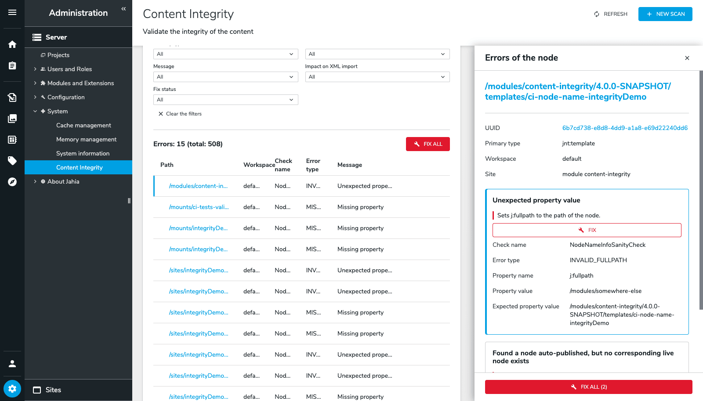

### Dealing with errors

#### Invalid j:fullpath property

`Error code: INVALID_FULLPATH`

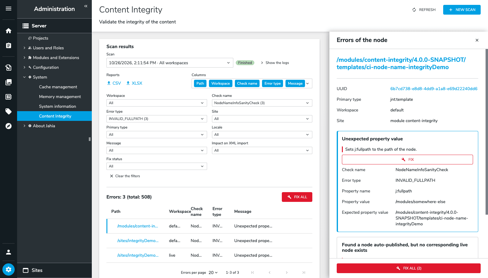

**Description**: when the property `j:fullpath` is defined, its value must be the current path of the node, in the workspace `default` and in the workspace `live`. The details of the error tell the current value and the expected one.

**Fix**: sets `j:fullpath` to the path of the node, with the listeners disabled, in the workspace where the error is reported.

#### Missing j:nodename property

`Error code: MISSING_NODENAME`

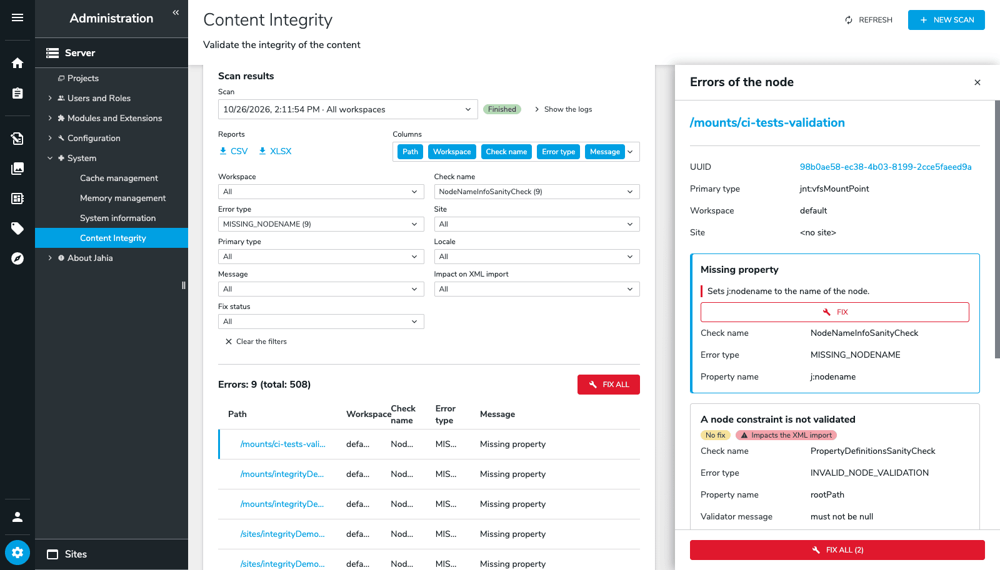

**Description**: `j:nodename` is set when the node is created or renamed. It should be defined on any node.

In the `default` workspace, renaming the node and then renaming it back to its current name should be sufficient to fix the error.
Then, the node needs to be republished to propagate the fix to the `live`, if relevant.
On UGC nodes, the property needs to be added using a script.

**Fix**: sets `j:nodename` to the name of the node, with the listeners disabled, in the workspace where the error is reported.

#### Invalid j:nodename property

`Error code: INVALID_NODENAME`

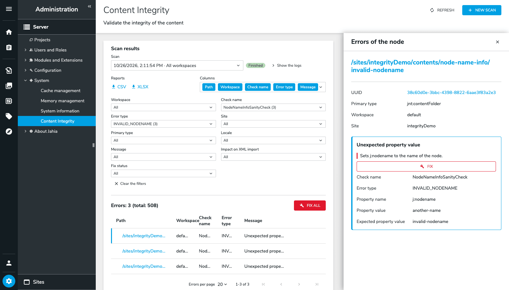

**Description**: `j:nodename` is set when the node is created or renamed. It should always be consistent with the node name. The details of the error tell the current value and the expected one.

In the `default` workspace, renaming the node and then renaming it back to its current name should be sufficient to fix the error.
Then, the node needs to be republished to propagate the fix to the `live`, if relevant.
On UGC nodes, the property needs to be modified using a script.

**Fix**: sets `j:nodename` to the name of the node, with the listeners disabled, in the workspace where the error is reported.

## PagesSanityCheck

Detects the pages whose template can't be resolved.

The check is enabled by default and runs on the nodes of type `jmix:hasTemplateNode`, such as the pages, and on the site nodes (`jnt:virtualsite`), in the `default` and the `live` workspaces. On a page, the template named by the property `j:templateName` is resolved from the various modules enabled on the site; a page without this property is not checked here, since the property is mandatory and its absence is reported by [PropertyDefinitionsSanityCheck](#propertydefinitionssanitycheck). On a site, the default template of the pages, `j:defaultTemplateName`, is checked when it is defined: it must be one of the page templates the pages of the site can use, the ones offered by the fix.

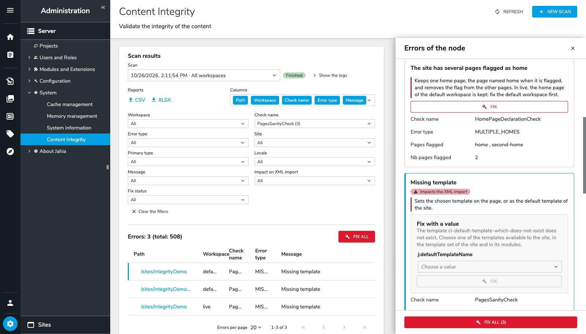

### Dealing with errors

#### Missing template

`Error code: MISSING_TEMPLATE`


**Description**: a page is using a template which can't be resolved from the various modules enabled on the site, or the default template of a site is not one of the page templates available to its pages. The details of the error tell the name of the missing template.

If the template is implemented in a module which is mistakenly missing, then installing this module back will fix the error.  
Otherwise, the page has to be edited to select another template. Note: the new template might use some different areas, and those related to the former template might need to be renamed or deleted.

**Fix**: in the details of the error, in the administration screen, choose the template in a dropdown, then click **Fix**. The dropdown lists the templates an editor can choose for the page: the page templates of the template set of the site and of its modules, which apply on the type of the page, are not hidden and are allowed on the site. The chosen template is set on the page, or as the default template of the site, and a template which is not in this list is refused. The right template can't be guessed, so **Fix all** skips this error, and the command `jcr:integrity-fix`, which provides no value, does not fix it.

## PropertyDefinitionsSanityCheck

Checks the validity of the content against the property definitions. 

The content must fit the definitions at the time it is written. But if the definitions are updated afterwards, then some pieces of content might not fit the new definitions. This can impact some features, such as updating some existing content through the UI, publishing, importing, ...

The check runs on both workspaces. The translation nodes (`jnt:translation`) are not checked on their own, but along with the node they belong to: an error on an internationalized property is reported on this node, in the language of the translation node.

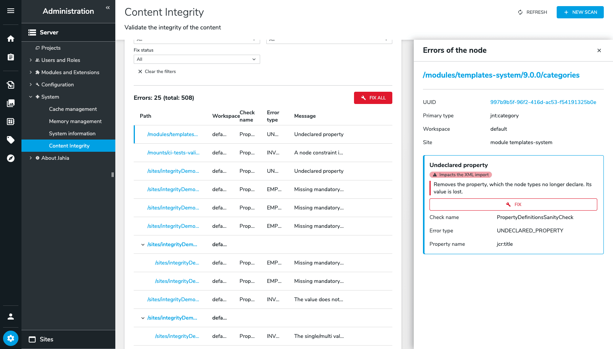

### Configuration

| Name                  |  Type   | Default Value | Description                                                                                                   |
|-----------------------|:-------:|:-------------:|---------------------------------------------------------------------------------------------------------------|
| site-langs-only       | boolean |     false     | If true, only the translation sub-nodes related to an active language are checked when the node is in a site  |
| check-node-validators | boolean |     true      | If false, the node validators are not checked (property constraints are checked no matter this configuration) |

### Dealing with errors

The details of each error name the property (`property-name`) and, when the definition is found, the type which declares it (`declaring-type`).

#### Missing mandatory property

`Error code: EMPTY_MANDATORY_PROPERTY`

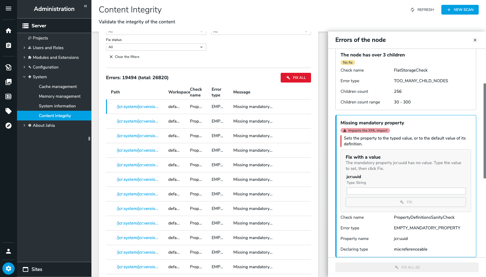

**Description**: A property is flagged as `mandatory` in the definitions, but has been detected with no value. A property whose values are all empty is considered as having no value. A mandatory internationalized property is checked on each translation node of the node.
                                     
If a few nodes are impacted, you should provide the list of nodes to the editors, and ask them to fill the invalid properties. Content should be updated in the `default` workspace, and the errors should be fixed in `live` through publication.

If an important number of nodes are impacted, then you should consider writing a script. The main difficulty is to define the appropriate value to set on those properties, without altering the output of the pages (a unique value might not be enough to cover all the cases). If the definitions file declares a default value, then this one is usually a good candidate, but you should nevertheless evaluate if switching from a `null` value to this default value will have an impact on the pages output.  
The script should be run with the listeners deactivated, and should be run on each workspace.

**Fix**: in the details of the error, in the administration screen, type the value, or choose it in a dropdown when the definition lists the accepted values, then click **Fix**. The value is converted to the type of the property and checked against its constraints: a boolean is `true` or `false`, a date is an ISO 8601 date such as `2026-01-31` or `2026-01-31T12:00`, a reference is the path or the identifier of an existing node, and a binary value can't be typed. When several mandatory properties of a node are missing, their values are saved together. **Fix all** skips this error. Without a value, as from the command `jcr:integrity-fix`, the fix sets the default value of the definition; without a default value, the error is not fixed. The nodes under `/modules` are not fixed: deploy a fixed version of the module instead.

On an access control entry (`jnt:ace`), the missing `j:roles` gives permissions: the roles are chosen in dropdowns, among the roles which can be given at the place of the entry. On content, these are the roles of the groups `edit-role` and `live-role`, on a site node the roles of the group `site-role` too, and out of the sites the roles of every group. The hidden roles are not offered. The details tell to which principal the roles are granted, or denied, and on which node. The error `NO_ROLES_PROP` of `AceSanityCheck` offers the same choice, and is not fixed without a value.

The missing `j:principal` of an access control entry is chosen in a dropdown, among the users and the groups which the entry can name: the ones of the server, and on a site, the ones of the site. The dropdown shows them in two groups, Users then Groups. The name of the entry tells its principal, `GRANT_u_john` for the user `john`: when that principal exists, it is suggested. The error `NO_PRINCIPAL` of `AceSanityCheck` offers the same choice. Without a value, as from the command `jcr:integrity-fix`, its fix deletes the entry. A fix of an access control entry is saved with the listeners enabled, so that the ACL listener updates what depends on it, such as the external entries of a role.

#### Invalid value type

`Error code: INVALID_VALUE_TYPE`


**Description**: A property has been detected with a value that does not match the declared type for the property. The details give the type of the value (`value-type`) and the type of the definition (`expected-value-type`). A `reference` value is accepted for a `weakreference` definition and the other way around, and a definition of type `undefined` accepts any value.

Changing the type of a property is not a supported operation.  

Nevertheless, it is something pretty usual during the initial development phase. In such case, you should consider deleting every node based on the type holding your property, in each workspace, and recreate some fresh test content, based on the updated definitions.  
                                                                        
If you need to change the type of a property on some production content, you should make the property `hidden` (and not indexed if of type `string`), and declare a new property of the desired type. Then, if you need to recover the content from the former property, you will need to write a script to copy the value (after a conversion if required).  
The script should be run with the listeners deactivated, and should be run on each workspace.

**Fix**: no automatic fix: the right value can't be guessed.

#### Invalid single/multi valued status

`Error code: INVALID_MULTI_VALUE_STATUS`


**Description**: A property has been detected with a value that does not match the declared single-value/multi-value type for the property. When the type of the value differs as well, `INVALID_VALUE_TYPE` is raised too.

Changing the type of a property is not a supported operation.

Nevertheless, it is something pretty usual during the initial development phase. In such case, you should consider deleting every node based on the type holding your property, in each workspace, and recreate some fresh test content, based on the updated definitions.

If you need to change the type of a property on some production content, you should make the property `hidden` (and not indexed if of type `string`), and declare a new property of the desired type. Then, if you need to recover the content from the former property, you will need to write a script to copy the value (after a conversion if required).  
The script should be run with the listeners deactivated, and should be run on each workspace.

**Fix**: no automatic fix: the right value can't be guessed.

#### Value breaking the constraints

`Error code: INVALID_VALUE_CONSTRAINT`

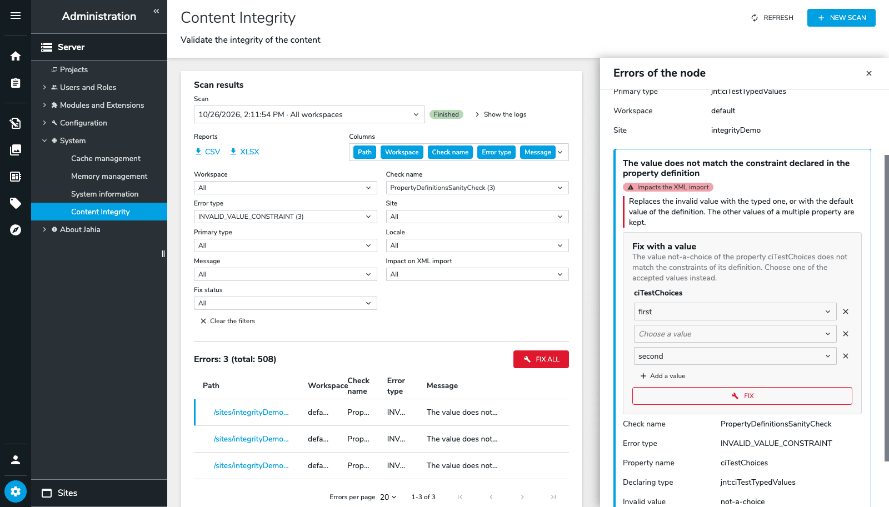

**Description**: A property has been detected with a value that does not match the constraints declared for the property, for example a value out of its list of accepted values. The details give the invalid value (`invalid-value`), its position in a multiple property (`value-index`), and the constraints of the definition (`constraints`).

**Fix**: in the details of the error, in the administration screen, choose the value in a dropdown when the definition lists the accepted values, or type a value which matches the constraints, then click **Fix**. On a multiple property, the other values are kept, and the value which breaks the constraints is left empty: an empty value is removed. **Fix all** skips this error. Without a chosen value, as from the command `jcr:integrity-fix`, the fix sets the default value of the definition, if any; without a default value, the error is not fixed. The nodes under `/modules` are not fixed: deploy a fixed version of the module instead.

#### Undeclared property

`Error code: UNDECLARED_PROPERTY`

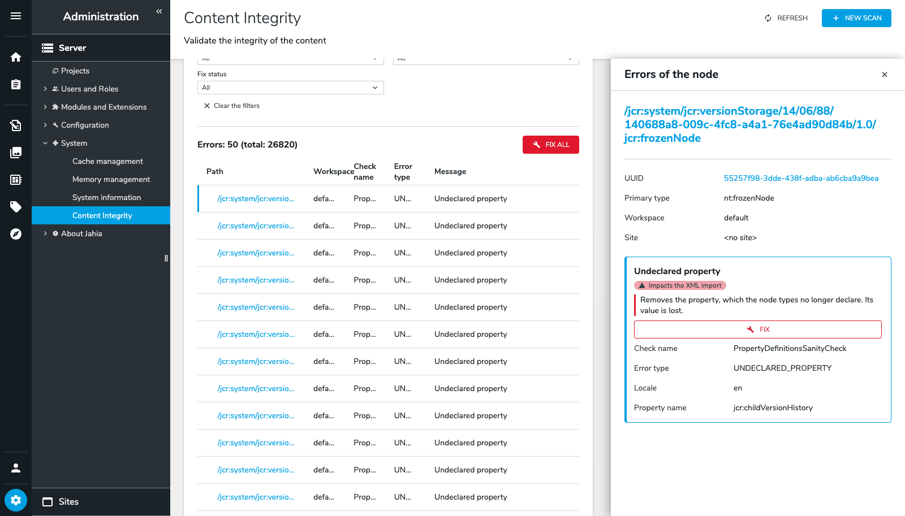

**Description**: A property of the node is declared by none of its types, primary type and mixins. This is usually the consequence of a property removed from the definitions, while some content still holds it. The error is raised as well when the property is declared, but internationalized while it is stored on the node itself, or not internationalized while it is stored on a translation node, and when the property matches only a residual definition (`*`) of another type, or of another single/multi valued status.

If the property is not used anymore, it can be deleted, in each workspace. Since it has no definition, it can't be removed through the Jahia API: a script has to remove it from the Jackrabbit node (`getRealNode()`), with the listeners deactivated.  
If the property is still needed, its definition has to be restored.

**Fix**: removes the property, which the node types no longer declare. Its value is lost.

#### Node validator constraint violation 

`Error code: INVALID_NODE_VALIDATION`


**Description**: A node validator raises a constraint violation when validating the node. The details give the message of the validator (`validator-message`) and the language used for the validation (`language-used-for-validation`).

The value of the properties have to be updated to get rid of the validation errors.

**Warning**: Those validators are not limited to validate a single property. A non internationalized property can be validated along with an internationalized one, and as a consequence the result of the validation might differ from one language to another one, even though the value of the non internationalized property remains the same. As a consequence, non internationalized properties are validated for each available language. This will usually lead to duplicated errors. Fixing it once will of course remove all the occurrences of error on the next scan. 

**Fix**: no automatic fix: a validator doesn't tell which value is expected.

## PublicationSanityDefaultCheck

Compares the nodes of the `default` workspace with their counterpart in the `live` workspace.

The check runs on the `default` workspace only, on the nodes of type `jmix:lastPublished`. A node is expected to exist in `live`, with the same identifier, when it is flagged as published (`j:published` is `true`), when it is of type `jmix:autoPublish`, or when it is under `/modules`.

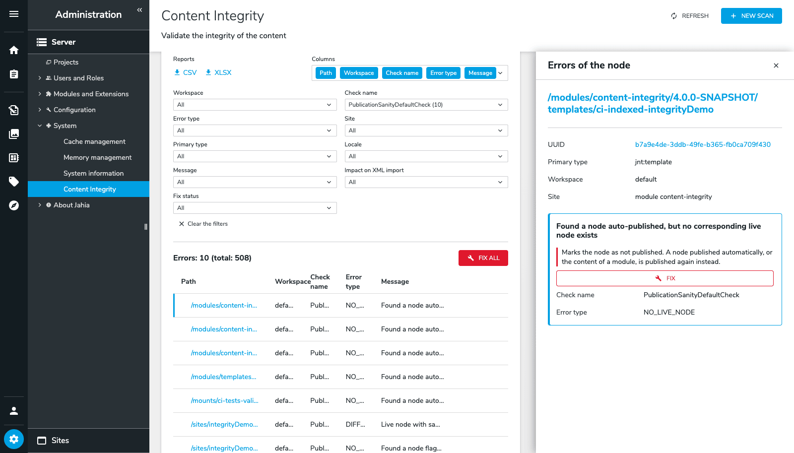

### Dealing with errors

#### No live node

`Error code: NO_LIVE_NODE`

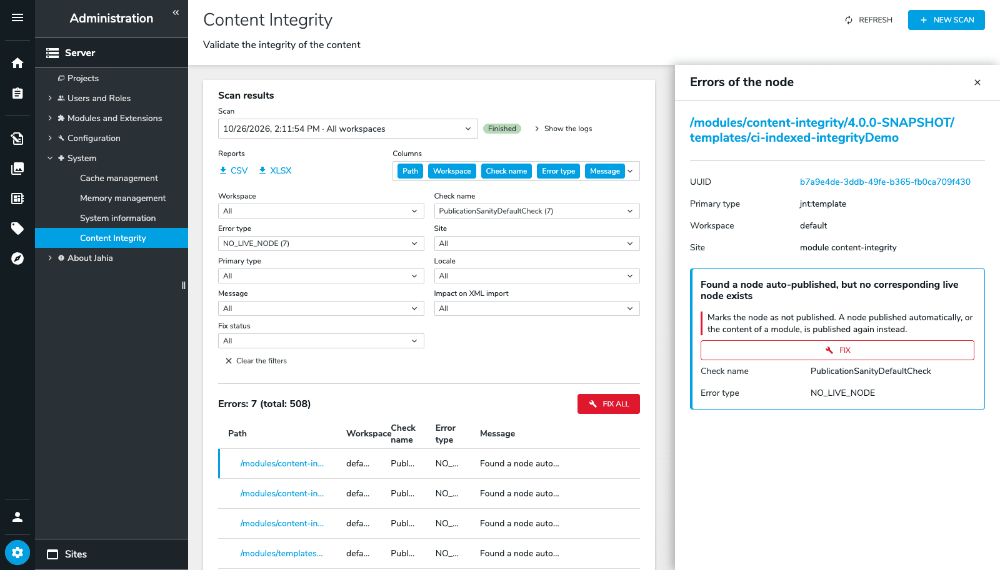

**Description**: When a node is flagged as published in the `default` workspace or is of type `jmix:autoPublish`, then a node with the same identifier must exist in the `live` workspace. The same applies to the nodes under `/modules`, which are published when the module is deployed.

If the node is flagged as published, but there's no live node with the same identifier, then you need to remove the property `j:published` from the node in the default workspace. Then you can republish the node if needed.

If the node is of type `jmix:autoPublish`, but there's no live node with the same identifier, then you can do any modification on the node in `default`, what should trigger the publication of the node.

If the node is under `/modules`, deploying the module again should publish it.

**Fix**: marks the node as not published, by removing the property `j:published`. A node of type `jmix:autoPublish`, and a node under `/modules`, whose content the deployment of its module publishes, are published again instead; the error is fixed only if the node then exists in `live`.

#### Different path in live

`Error code: DIFFERENT_PATH`, `Error code: DIFFERENT_PATH_POTENTIAL_FP`


**Description**: If the node has no pending modification, then the path must be the same in the two workspaces. The path of the node in `live` is given in the details of the error (`live-node-path`).

Only the highest node of a subtree is reported: the nodes under a node whose path differs are not checked against this rule.

`DIFFERENT_PATH_POTENTIAL_FP` is raised instead of `DIFFERENT_PATH` when the node is the root of the scan, and not the root of the JCR. The error might then be a false positive: if one of the parent nodes has been moved or renamed, without publishing this operation, the path of every node of its subtree differs between the two workspaces, and only this parent node has pending modifications. To clarify this, analyze the parent nodes, or scan again from a higher node.

If the node has no pending modification but its path differs in the `live` workspace, then you can do a fake modification on the node (for example, adding some blank at the end of a richtext, or changing the value of a property, and then setting back the initial value) in order to get back the possibility to publish the node.

**Fix**: no automatic fix: the error needs an analysis.

#### Live node with the same path but a different uuid

`Error code: PATH_CONFLICT`


**Description**: A live node has the same path but a different uuid. As a consequence, publishing the current node is not possible.

The details of the error give the identifier (`live-node-uuid`) and the primary type (`live-node-primary-type`) of the `live` node, and the path in the `default` workspace of the node which has this identifier (`conflicted-edit-node`), or `none` if no such node exists.

Errors require a case by case analysis.

If the `live` node is a UGC node: either the `live` node or the `default` node has to be renamed to not conflict anymore.

If the `live` node is not a UGC node, it must have a different path in the `default` workspace. Usually, such conflict is a consequence of a renaming or move operation which has not been published yet. Publishing this second node will update its path in `live`, ending the conflict up. If `conflicted-edit-node` is `none`, the `live` node doesn't exist in the `default` workspace: see the errors of `PublicationSanityLiveCheck` on this node.

**Fix**: no automatic fix: the error needs an analysis.

#### Live node with a different primary type

`Error code: DIFFERENT_PT`


**Description**: The node is published, but the node with the same identifier in the `live` workspace has another primary type, given in the details of the error (`live-node-primary-type`).

It is not possible to change the primary type of a node. The `live` node has to be deleted, for example with a script, and the node republished from the `default` workspace, along with its subtree.

**Fix**: no automatic fix: the error needs an analysis.

## PublicationSanityLiveCheck

In the `live` workspace, nodes are either published nodes or UGC nodes.   
UGC nodes are flagged as such. All the other nodes are expected to exist as well in the `default` workspace, with the same identifier.  
For the published nodes, if the node with the same identifier in the `default` workspace has no pending modification, then the various properties set on the nodes must have the same value in the two workspaces (optional check).

The check runs on the `live` workspace only, and skips the external nodes.

A node is flagged as UGC when its property `j:originWS` (mixin `jmix:originWS`) is `live`. Some nodes don't have this mixin, for example the access control entries, so the check can't tell if they are UGC nodes: they are assumed to be, unless `report-live-only-undefined-ugc-nodes` is enabled. The permissions under `/modules`, created in `live` when the module is installed, and the translation nodes holding only `jcr:*` properties, are always considered as UGC nodes.


### Configuration

| Name                                 |  Type   | Default Value | Description                                                                                                                                                                               |
|--------------------------------------|:-------:|:-------------:|-------------------------------------------------------------------------------------------------------------------------------------------------------------------------------------------|
| deep-compare-published-nodes         | boolean |     false     | If true, the value of every property will be compared between default and live on the nodes without pending modification                                                                  |
| report-live-only-undefined-ugc-nodes | boolean |     false     | If true, the nodes which exist only in live, and for which we don't track if they are UGC nodes, will be reported as errors. Most of those errors should be considered as false positives |

### Dealing with errors

#### Missing node in the `default` workspace for a non UGC node

`Error code: NO_DEFAULT_NODE`


**Description**: The node is not flagged as UGC, but no node exists in the `default` workspace with the same identifier.

A technical node, such as an access control entry or a reference in a text, is not reported when the node to which it is attached is itself missing in `default` (the error is reported on this node), or when this node has pending modifications.

Errors require a case by case analysis.

If the node should be flagged as a UGC node, you need to set the property `j:originWS` to `live` on the node.

If the node is the remaining of a failed deletion, which has been completed only in the `default` workspace, then you need to delete the remaining `live` node.

If the node is incorrectly missing in `default`, you need to delete the `live` node, recreate the `default` node, and republish it.

**Fix**: publishes the node from the `live` workspace to the `default` workspace, which restores it there. No content is lost, but a node deleted on purpose comes back in `default`, where it can be deleted again and the deletion published. The error is fixed only if the node then exists in `default`.

#### UGC node which exists in the `default` workspace

`Error code: UNEXPECTED_UGC`


**Description**: The node is flagged as UGC (`j:originWS` is `live`), but a node with the same identifier exists in the `default` workspace. A UGC node is created in `live` and has no counterpart in `default`.

**Fix**: sets `j:originWS` to `default`: the node is no longer user generated content.

#### Missing `j:originWS` property

`Error code: INCONSISTENT_UGC`


**Description**: The node has the mixin `jmix:originWS`, but not its property `j:originWS`. It is not possible to tell if the node is a UGC node.

If the node exists in the `default` workspace, it is a published node, and `j:originWS` has to be set to `default`. Otherwise, it is a UGC node, and `j:originWS` has to be set to `live`.

**Fix**: sets `j:originWS` to `default` when the node exists in the `default` workspace, else to `live`.

#### Differences between a published node and its live node

`Error code: MISSING_PROP_LIVE`, `Error code: MISSING_PROP_DEFAULT`, `Error code: DIFFERENT_PROP_VAL`, `Error code: DIFFERENT_MIXINS`


**Description**: These errors are raised only when `deep-compare-published-nodes` is enabled, on the nodes which exist in both workspaces and have no pending modification in `default`, the root node of the JCR excepted. The name of the property is given in the details of the error (`property name`).

* `MISSING_PROP_LIVE`: a property of the `default` node is missing on the `live` node.
* `MISSING_PROP_DEFAULT`: a property of the `live` node is missing on the `default` node, and is not listed as a UGC property in `j:liveProperties`. Known issue: the UGC internationalized properties are not tracked in `j:liveProperties`, so this error might be a false positive on a translation node.
* `DIFFERENT_PROP_VAL`: the property has a different value in the two workspaces.
* `DIFFERENT_MIXINS`: the mixins differ between the two workspaces. The details list the mixins found only in `default` (`default-only-mixins`) and only in `live` (`live-only-mixins`). `jmix:deletedChildren` in `default`, `jmix:liveProperties` in `live`, and the mixins added in `live` as UGC (tracked in `j:liveProperties`) are ignored.

The properties which legitimately differ between the workspaces are not compared: the lock properties (`jcr:lockOwner`, `jcr:lockIsDeep`, `j:lockTypes`, `j:locktoken`), `j:fullpath`, `j:nodename`, `j:deletedChildren`, `j:liveProperties`, `jcr:lastModified`, `jcr:lastModifiedBy`, the versioning properties (`jcr:baseVersion`, `jcr:predecessors`), and `jcr:mixinTypes`, compared separately.

Since the node has no pending modification, it can't be republished as is. You can do a fake modification on the node in `default` (for example, changing the value of a property, and then setting back the initial value), and then republish it, so that the `live` node gets the values of the `default` node. If the value of the `live` node is the right one, update the `default` node before republishing.

**Fix**: no automatic fix: the right value can't be guessed, the differences need an analysis.

## ReferencesSanityCheck

When properties of type `weakreference` or `reference` have a value, this value is a reference to another node in the same workspace.
Properties of type `weakreference` can hold a broken reference by design (this should not be possible with `reference`), mostly when you delete a node which is referenced from another one.

The check runs on both workspaces. The properties declared by `mix:versionable`, which link the node to its version history, are checked only when `validate-version-history` is enabled. The back references are not checked on the external nodes.


### Configuration

| Name                     |  Type   | Default Value | Description                                                                                                                                                  |
|--------------------------|:-------:|:-------------:|--------------------------------------------------------------------------------------------------------------------------------------------------------------|
| validate-refs            | boolean |     true      | If true, the value of every property of type `reference` / `weakreference` will be inspected                                                                 |
| validate-back-refs       | boolean |     false     | If true, the references pointing to the current node will be evaluated. This operation is time consuming and will increase the scan duration                 |
| validate-version-history | boolean |     false     | If true, the references used to link the node to its version history will be evaluated. This operation is time consuming and will increase the scan duration |

### Dealing with errors

#### Broken references

`Error code: BROKEN_REF`


**Description**: the property has a not `null` value, but the referenced node is missing. The details give the name of the property (`property-name`) and the missing identifier (`missing-uuid`). A broken reference held by a translation node is reported on the node it belongs to, in the language of the translation node.

If the property is single-valued, then its value should be set to null, or another node should be referenced. If the property is mandatory, only the latter option is possible.

If the property is multi-valued, the invalid value should be removed from the list if some other values are valid, or the values should be updated.

**Fix**: removes the reference to the missing node: the missing value of a multiple property, else the whole property. A multiple property whose only value is the missing one is removed. On a mandatory property, the fix leaves a missing mandatory property, reported by `PropertyDefinitionsSanityCheck`, whose fix takes the node to reference.

#### Broken references to a virtual node

`Error code: BROKEN_REF_TO_VN`


**Description**: the missing referenced node is a virtual node: its identifier is known in the mapping of the external nodes (table `jahia_external_mapping`), but the node can't be resolved.

If the virtual node is temporarily missing, for example because of a connectivity issue at `DataSource` level, the error has to be considered as false positive.

If the virtual node is gone forever, then the property should be fixed the same way as for a regular node.

**Fix**: no automatic fix: the provider of the virtual node might be temporarily unavailable.

#### Invalid back references

`Error code: INVALID_BACK_REF`

**Description**: the node is referenced by a node which is missing. This error is raised only when `validate-back-refs` is enabled. The details give the name of the referencing property (`property-name`) and the path of the referencing node (`referencing-node-path`).

This can happen only when the node holding the reference is a virtual node, the property is not virtual, and this node is not exposed by the `DataSource` at the time of the scan.

If the virtual node is temporarily missing, for example because of a connectivity issue at `DataSource` level, the error has to be considered as false positive.

If the virtual node is gone forever, then the extension node should be deleted from the JCR, what will clean the reference as well.

**Fix**: no automatic fix.

## SiteLevelSystemGroupsCheck

A Jahia server must have a server level group named `privileged`, and each site must have a site level group named `site-privileged`.  
Each `site-privileged` group must be member of the `privileged` group.

The check runs on the site nodes, in the `default` workspace.


### Dealing with errors

If a `site-privileged` group is not member of the `privileged` group, you need to restore this membership.

If the `privileged` group is missing, you will need to recreate it, and then add every `site-privileged` group as a member.

If the `site-privileged` group is missing, you will need to recreate it. Then, it will be required to identify the users/groups which need to be member of this group. 

#### Missing system group

`Error code: GROUP_DOES_NOT_EXIST`


**Description**: a system group does not exist. The details tell the name of the group.  
The group `privileged` is created at server level when the server is installed: when it is missing, a single error is raised, on the root node.  
The group `site-privileged` is created at site level when the site is created: when it is missing, the error is raised on the site, and the details tell the site.

**Fix**: creates the missing group again, as Jahia does for a new site: `site-privileged` is a member of `privileged`, and its members are the users and groups granted a privileged role in the site.  
More precisely, the group `privileged` is created at server level, hidden, and the group `site-privileged` of every site is added to its members. The group `site-privileged` is created in the site, added to the members of `privileged`, and its members are the principals granted, by an entry of type `GRANT` in the site, a role with a privileged access (`j:privilegedAccess`). It is granted the role `privileged` on the site, where `privileged` is denied this role, and on the folders `users` and `groups` of the site, except on `systemsite` where only the folders are concerned. The access control lists changed are published when their node exists in `live`.

#### Missing membership

`Error code: MISSING_MEMBERSHIP`


**Description**: the group `site-privileged` of the site is not a member of the group `privileged`. The details tell the site. The error is not raised when one of the groups is missing: this is reported with `GROUP_DOES_NOT_EXIST`, whose fix restores the membership as well.

**Fix**: adds the group `site-privileged` of the site to the members of the group `privileged`.

## StaticInternalLinksCheck

In the rich text editor, one should use the "link" feature to create internal links, select a page, and let the software create the internal link correctly.
But it happens that users copy the URL of a page from their browser's address bar, and paste it in the editor. As a consequence, the internal link is not considered as such, and is handled as an external link. As a consequence, the link gets broken if the target page is renamed or moved. And no warning is displayed if one deletes the target page.

This check iterates the properties of type `string` and reports any occurrence of a domain declared on one of the websites (primary domain or alternative one).  
The domains are read on the sites of the `live` workspace when the scan starts, and the check is skipped when no domain is declared. Every value of the multiple properties is checked. A value is reported when it contains the domain anywhere, as a part of a longer host name as well. The domains declared on a site node (`j:serverName`, `j:serverNameAliases`) are not reported.

This check is disabled by default since the effect of the reported errors has a functional impact more than is a technical inconsistency, and because there's a high risk of false positives. 


### Configuration

| Name                     |  Type   | Default Value | Description                                                          |
|--------------------------|:-------:|:-------------:|----------------------------------------------------------------------|
| ignore-localhost         | boolean |     true      | If true, only the domains different from `localhost` will be scanned |

### Dealing with errors

#### Hardcoded domain of a site

`Error code: HARDCODED_DOMAIN`


**Description**: a value of a property of type `string` contains the domain of a site. An error is raised for each value and each domain it contains. The details tell the property, the value, shortened around the domain when it is longer than 200 characters, and the domain.

If a reported error is qualified as legit, then the content has to be fixed manually and republished if the error is present in live as well.

**Fix**: no automatic fix: the right link can't be guessed, and the value has to be edited in the content.

## TemplatesIndexationCheck

Detects the templates (`jnt:template`) of the modules which are not correctly indexed. The templates are resolved with queries, which rely on the search index: a template missing from the index is not found, and the pages using it can't be rendered as expected.

The check runs on the templates under `/modules`, in every workspace. Every version of a module found under `/modules` is checked, no matter if it is started or not: a template not indexed in a stopped version has no functional impact immediately, but it would have one if this version was started.


### Dealing with errors

#### Template not indexed

`Error code: NOT_INDEXED_TEMPLATE`


**Description**: a query on the templates of the module version, by the name of the template, does not return the template.

If a template is not correctly indexed, you can simply reindex it from the `JCR browser` in the tools. If several templates are identified, you can also reindex the whole subtree of the module.  
Then, you need to flush the cache, or at least the cache named `RenderService.TemplatesCache`.

If you suspect that the issue is not related to a module deployment error, then you should consider a full re-indexation of the JCR.

**Fix**: no automatic fix: the template has to be reindexed.

## UndeclaredNodeTypesCheck

Each node has a primary type, and can have been added some mixin types. If a type assigned to a node can't be loaded, then you might encounter some issues when manipulating the node.

The check runs on both workspaces. The details of an error give the type, as `primary type` or as `mixin type`.


### Dealing with errors

#### Undeclared type

`Error code: UNDECLARED_NODE_TYPE`


**Description**: the node type is not registered in the `NodeTypeRegistry`. The error is raised as well when the type is registered, but a mixin is used as primary type, or a primary type as mixin.

First, check the reason why some node types / mixin types are missing. The module which defines them might be missing or not correctly installed. In such case, you need to restore the module in a correct state to fix the issue.

Otherwise, if the missing types have been decommissioned, then no node should refer to them anymore.

**Primary type**: you will probably need to delete every related node. If you need to recover some data from the properties of the node, you will need to write a script to copy the values to a new node, of another type. It is not possible to change the primary type of a node. You might need to introduce back the removed node type definition for the good execution of the script, and then remove it forever.

**Mixin type**: you can remove the mixin from the nodes. If a few nodes are impacted, you can do it from the JCR browser. Otherwise, you will need to write a script. If the mixin used to define some properties, then you should clean them from the node as well. In such case, writing a script will be the best option. You might need to introduce back the removed mixin type definition for the good execution of the script, and then remove it forever.

**Fix**: removes the undeclared mixin from the node. When the primary type is undeclared, deletes the node and its subtree, which can't be undone. Restore the module first if the type is missing by mistake, since **Fix all** applies this fix too.

#### Ghost type

`Error code: GHOST_NODE_TYPE`


**Description**: the node type is still registered in the `NodeTypeRegistry`, but it is bound to a module which is not started, or which doesn't declare it anymore in its definitions file.

If the type has actually been deleted, in addition to the cleanup to be done on the JCR nodes (see `Error code: UNDECLARED_NODE_TYPE`), the type has to be purged from the `NodeTypeRegistry`. This can be achieved manually in the tools, using the "Definitions browser" (warning: this deletes the related nodes as well).

If the type has been moved from a module to another one, but is still bound to the first one, then the type has to be purged from the `NodeTypeRegistry`, and the second module has to be reinstalled to redeclare the type, but bound to the correct module. In this case, the related nodes are likely to be preserved. As a consequence, prefer using a Groovy script to undeclare the node type from the `NodeTypeRegistry`:

```
NodeTypeRegistry.getInstance().unregisterNodeType("mynt:movedType");
```

**Fix**: removes the undeclared mixin from the node. When the primary type is undeclared, deletes the node and its subtree, which can't be undone. Do not use it when the type has been moved to another module, or when its module is only stopped: the nodes would be lost, while restoring the declaration of the type preserves them.

## UndeployedModulesReferencesCheck

When you enable a module on a site, then a property is written on the site node to track this information.  
Only currently deployed modules should be referred to in this list.  

The check runs on the site nodes, in the `default` workspace, and compares the modules listed in the property `j:installedModules` with the modules deployed on the server.


### Dealing with errors

#### Undeployed module enabled on a site

`Error code: UNDEPLOYED_MODULE_ON_SITE`


**Description**: the site lists in `j:installedModules` a module which is not deployed on the server. An error is raised for each module. The details tell the module.

If the module should be deployed, then deploying it back on the server will fix the issue on the site.

If the module was undeployed for good reasons, then you need to clean the site node. You can easily achieve it from the Karaf shell.

    root@dx()> jcr:cd /sites/digitall
    root@dx()> jcr:prop-set -multiple -op remove j:installedModules myOldModule 

**Fix**: removes the module from the modules of the site, in both workspaces. When the module is available again at the time of the fix, the site is left unchanged, and the error is reported as fixed. When the module is installed but not available, for example not started, the site most likely needs it: it is left unchanged, and the error is reported as not fixed, with the advice to start the module, or to uninstall it to unreference it.

## UnreadablePublicationStatusCheck

Detects `jmix:i18n` nodes for which the workflow and delete status cannot be read by the publication service.

When computing publication info, `ComplexPublicationServiceImpl` calls `session.getNodeByUUID(uuid)` on a locale-specific session for each language a node is translated into. If the node's path cannot be resolved in that locale (typically because the node or one of its ancestors is missing the corresponding translation sub-node), Jahia throws a `PathNotFoundException` wrapped as an `ItemNotFoundException`, and logs the warning:

```
Issue when reading workflow and delete status of node <path>
```

This check replicates that lookup: for every `j:translation_<lang>` child found on an `jmix:i18n` node, it attempts to load the parent node by identifier via a locale-specific system session. A failure is reported as an integrity error. The check runs on both the `default` and `live` workspaces.


### Dealing with errors

#### Node unreadable in the language of a translation

`Error code: UNREADABLE_PUBLICATION_STATUS`


**Description**: The node has a `j:translation_<lang>` child but cannot be loaded via a localized JCR session for that language. This blocks the publication service from computing the publication status of the node and its subtree. The error is reported in this language, which is also given in the details of the error (`locale`).

The root cause is usually one of the following:

- An ancestor of the reported node has `jmix:i18n` but is missing the translation for the affected language (e.g. the ancestor's `j:translation_<lang>` was deleted while the descendant's was not, or vice-versa).
- A database or datastore failure partially wrote or deleted a translation node, leaving the tree in an inconsistent state.
- In the `live` workspace, the translation is in a language which is not active in live on the site, for example a language deactivated after the content was published.

To fix the issue, identify which node in the path is missing its translation for the reported locale. Then either:

- Restore the missing translation node (recreate `j:translation_<lang>` on the ancestor and republish).
- Or, if the orphaned translation sub-node on the reported node is the cause, delete it.

If the language is not active in live on the site, either activate it again, or delete the translation sub-nodes of this language from the `live` workspace.

In the `live` workspace, deleting the problematic node or its orphaned translation directly via a Groovy script is often the quickest way to unblock publication:

```groovy
def session = org.jahia.services.content.JCRSessionFactory.getInstance()
                  .getCurrentSystemSession("live", null, null)
def node = session.getNode("/sites/mySite/path/to/node")
node.remove()
session.save()
```

**Fix**: no automatic fix: the missing translation and the node to delete need an analysis.

## UserAccountSanityCheck

Detects the cases where the user is not granted the role `owner` on his own account.

When a user account is created, the user is granted the role `owner` on its node (`jnt:user`), which lets him edit his own profile. The check runs on the user nodes, in every workspace, and reports a user who is named in the access control entries of his account node, but is not granted the role `owner` on the node itself. The user `guest` is ignored, since he is not owner of his node.


### Dealing with errors

#### User not owner of his account

`Error code: NOT_OWNER`


**Description**: the access control entries of the account node name the user, but none grants him the role `owner` on this node.

User accounts are auto published. If the error is detected on the same user node in both workspaces, then fixing it in the `default` workspace will actually fix the issue in both.

You can run a groovy script to grant the missing role:

```
def userName = "john";
def site = "digitall";
def userNode = JahiaUserManagerService.getInstance().lookupUser(userName, site);
Set roles = ["owner"];
userNode.grantRoles("u:" + userName, roles);
userNode.saveSession();
```

**Fix**: grants the role `owner` to the user on its account. The other roles of the user are kept.

## VersionHistoryCheck

Detects the nodes having a too long linear version history (100 versions by default, can be configured).  
Such nodes will impact the performance.

This check is disabled by default. It runs on the nodes of type `mix:versionable`, and skips the external nodes. The version history is shared by the two workspaces: in the `live` workspace, a node which exists in the `default` workspace is not checked again.


### Configuration

| Name      |       Type        | Default Value | Description                                                           |
|-----------|:-----------------:|:-------------:|-----------------------------------------------------------------------|
| threshold | positive integer  |      100      | Number of versions for a single node beyond which an error is raised  |

### Dealing with errors

#### Too many versions

`Error code: TOO_MANY_VERSIONS`


**Description**: the version history of the node holds more versions than the threshold. The details give the number of versions (`versions-count`), and tell if the node is of type `jmix:autoPublish` (`auto-publish`).

You can purge the version history of every node in the tools, keeping only the most recent versions. Otherwise, you can write a script to purge the complete history of some specific nodes. 

Example:

```groovy
import org.jahia.services.history.NodeVersionHistoryHelper

NodeVersionHistoryHelper.purgeVersionHistoryForNodes(Collections.singleton(nodeIdentifier))
```

**Fix**: purges the versions of the node which are not used, as the script above does. The versions still used, for example by the `default` and the `live` nodes, are kept. The error is not fixed when more versions than the threshold remain.

## VersionSanityCheck
    
Analyzes the versions tree, and checks the consistency of the version nodes.  
The versions tree is not scanned by default. To have this test executed, the scan root node must be `/jcr:system`, `/jcr:system/jcr:versionStorage` or any other node under.  
In addition to the identified errors, the check will compute some statistics about the scanned tree. To analyze a specific subtree of the version storage, just run the scan from this tree.

This check is disabled by default. It runs on the version histories (`nt:versionHistory`) under `/jcr:system/jcr:versionStorage`.


### Dealing with errors

The check provides no automatic fix.

#### Orphaned version history

`Error code: ORPHANED_HISTORY`


**Description**: the versioned node of the version history, read from the frozen node of its versions (`jcr:frozenUuid`), exists neither in the `default` workspace nor in the `live` workspace. The details give the number of versions of the history (`nb-version-nodes`).

An orphaned version history is useless, and only takes some space in the database. The page of the Jahia tools which manages the version history can detect and delete the orphaned version histories.

#### Orphaned version histories in the scanned tree

`Error code: ORPHAN_IN_SUBTREE`


**Description**: raised once, on the root node of the scan, when at least one orphaned version history has been found. The details hold the statistics of the scanned tree: the number of version histories (`version-histories-count`), of orphaned ones (`orphaned-version-histories-count`, `orphaned-version-histories-ratio`), the number of versions (`total-nb-version-nodes`), of versions in the orphaned histories (`total-nb-orphan-version-nodes`, `orphaned-version-nodes-ratio`) and in the other ones (`total-nb-non-orphan-version-nodes`), and the number of versions which could be deleted (`total-nb-deletable-version-nodes`).

This error summarizes the `ORPHANED_HISTORY` errors, and is dealt with the same way.

#### Version history without versioned node identifier

`Error code: HISTORY_WITHOUT_NODE_ID`

**Description**: the version history has no `jcr:versionableUuid` property, which identifies the versioned node. This property is protected, and set by the version manager: such a history has been altered below the JCR API, for example in the database.

The version history can't be related to a node. Its subtree has to be analyzed, for example from the JCR browser of the tools, to decide if it can be deleted.

## WipSanityCheck

The `work in progress` feature has been redesigned in Jahia 7.2.3.1 .  
As a consequence, the data model of the technical information stored on the nodes flagged as `work in progress` has been updated. If your project has started before Jahia 7.2.3.1 , the data related to the `work in progress` is supposed to have been converted to the new model while migrating, and no property related to the legacy model should remain on your nodes.

In the current model, the state is held by the property `j:workInProgressStatus`, whose value is `DISABLED`, `ALL_CONTENT` or `LANGUAGES`, and, with the status `LANGUAGES`, by the property `j:workInProgressLanguages`, which lists the languages in work in progress. The legacy model used the boolean property `j:workInProgress`.

The check is enabled by default, on Jahia 7.2.3.1 and later. It runs on the nodes of type `jmix:lastPublished` or `jnt:translation` which have at least one of the properties `j:workInProgress`, `j:workInProgressStatus` or `j:workInProgressLanguages`, in the `default` and the `live` workspaces. In the `live` workspace, only the error `WIP_IN_LIVE` is reported. An empty `j:workInProgressLanguages` names no language, and is treated as an absent one: Content Editor creates it this way on new nodes.


### Dealing with errors

If some properties related to the legacy model are identified on some nodes, you should write a script to clean them up. Those properties are completely ignored after the refactoring, so deleting them will have no functional impact.

The fixes write with the listeners disabled, in the workspace where the error is reported.

#### WIP property on a translation node

`Error code: WIP_ON_TRANSLATION_NODE`


**Description**: the work in progress state is stored on the content node, not on its translation nodes. One error is raised for each of the properties `j:workInProgress`, `j:workInProgressStatus` and `j:workInProgressLanguages` found on a translation node. The details of the error tell the name of the property.

**Fix**: removes the work in progress property from the translation node.

#### Legacy WIP property

`Error code: WIP_LEGACY_FORMAT`


**Description**: the node has the property `j:workInProgress`, from the model used before Jahia 7.2.3.1.

**Fix**: removes the legacy property `j:workInProgress`.

#### Language which is not a language of the site

`Error code: WIP_UNEXPECTED_LANG`


**Description**: the status is `LANGUAGES`, and `j:workInProgressLanguages` lists a language which is not a language of the site of the node. One error is raised for each such language. The details of the error tell the language and the languages of the site.

If the language has been removed from the site on purpose, the error can be fixed. If the language is expected, check the configuration of the languages of the site.

**Fix**: removes the language from the work in progress languages. The node is no longer in work in progress when no language is left: `j:workInProgressStatus` and `j:workInProgressLanguages` are then removed.

#### Missing WIP languages

`Error code: WIP_MISSING_PROP`


**Description**: the status is `LANGUAGES`, but the node has no property `j:workInProgressLanguages`, so it doesn't tell which languages are in work in progress.

If some languages have to stay in work in progress, flag them again from the UI after the fix.

**Fix**: removes the work in progress status: the node is no longer in work in progress.

#### Unexpected WIP languages

`Error code: WIP_UNEXPECTED_PROP`


**Description**: `j:workInProgressLanguages` lists some languages, while the status is `ALL_CONTENT` or `DISABLED`, or while the node has no `j:workInProgressStatus`. The languages are only relevant with the status `LANGUAGES`.

**Fix**: removes the work in progress languages. The status, if any, is kept.

#### Inconsistent WIP status

`Error code: WIP_INCONSISTENT_STATUS_PROP`


**Description**: the value of `j:workInProgressStatus` is none of `DISABLED`, `ALL_CONTENT` and `LANGUAGES`. The details of the error tell the value.

If the content has to stay in work in progress, flag it again from the UI after the fix.

**Fix**: removes the work in progress status and languages: the node is no longer in work in progress.

#### WIP property in the `live` workspace

`Error code: WIP_IN_LIVE`


**Description**: the `work in progress` state is an editing state. No WIP property (`j:workInProgress`, `j:workInProgressStatus`, `j:workInProgressLanguages`) is expected in the `live` workspace. The details of the error tell the properties found.

**Fix**: removes the work in progress properties from the `live` node. The error can be fixed with the command `jcr:integrity-fix` as well.

## WorkspaceSpecificDefinitionsCheck

Detects the types and the properties which are expected in a single workspace, but are found in the other one, as well as the properties which are expected in a workspace only with some value.  
For example, the deletion marks (`jmix:markedForDeletion`, `jmix:markedForDeletionRoot`) are editing states, which exist only in the `default` workspace, and a node in `live` is never in work in progress.

The check runs in the `default` and the `live` workspaces. In a workspace, it reports the types and the properties declared as specific to the other workspace, and the properties declared with a value for this workspace. When nothing is declared for the scanned workspace, the check is skipped.


### Configuration

| Name                             |  Type  |                    Default Value                     | Description                                                                                                                                                       |
|----------------------------------|:------:|:----------------------------------------------------:|-------------------------------------------------------------------------------------------------------------------------------------------------------------------|
| ws-default-specific-types        | string | `jmix:markedForDeletion,jmix:markedForDeletionRoot` | Types which should be defined only in the `default` workspace (comma separated, spaces allowed)                                                                   |
| ws-default-specific-props        | string |                                                      | Properties which should be defined only in the `default` workspace (comma separated, spaces allowed)                                                              |
| ws-default-specific-props-values | string |                                                      | Properties which should be defined in the `default` workspace only with the specified value (format `propertyName==value`) or only with a value different from the specified one (format `propertyName!=value`) (comma separated, spaces allowed) |
| ws-live-specific-types           | string |                                                      | Types which should be defined only in the `live` workspace (comma separated, spaces allowed)                                                                      |
| ws-live-specific-props           | string |                                                      | Properties which should be defined only in the `live` workspace (comma separated, spaces allowed)                                                                 |
| ws-live-specific-props-values    | string |         `j:workInProgressStatus==DISABLED`          | Properties which should be defined in the `live` workspace only with the specified value (format `propertyName==value`) or only with a value different from the specified one (format `propertyName!=value`) (comma separated, spaces allowed) |

A type matches the node when the node is of this type, through its primary type, a mixin, or their supertypes. A value declaration without `==` or `!=`, or without a property name or a value, is ignored. Since the declarations are comma separated, a value can't contain a comma.

### Dealing with errors

When the unexpected type or property comes from the other workspace, it has usually been copied there by a publication or an import, or written there by a script. Check if the node is also reported by a check dedicated to this state: in `live`, a deletion mark is reported by [MarkForDeletionCheck](#markfordeletioncheck) (`DELETION_MARK_IN_LIVE`), and a work in progress property by [WipSanityCheck](#wipsanitycheck) (`WIP_IN_LIVE`).

#### Type not allowed in the workspace

`Error code: UNEXPECTED_TYPE`


**Description**: the node is of a type declared as specific to the other workspace. The details tell the type.

**Fix**: removes the mixin from the node. A deletion mark is removed by canceling the deletion: the node is marked for deletion, then unmarked. The node is saved with the listeners disabled. When the type is the primary type of the node, or is carried by it, the error is not fixed.

#### Property not allowed in the workspace

`Error code: UNEXPECTED_PROP`


**Description**: the node has a property declared as specific to the other workspace. The details tell the property.

**Fix**: removes the property from the node, with the listeners disabled.

#### Property value not allowed in the workspace

`Error code: UNEXPECTED_PROP_VALUE`


**Description**: the node has a property declared with a value for this workspace, but its value breaks the declaration: it differs from the value of a `==` declaration, or equals the value of a `!=` declaration. With the default configuration, it is raised in `live` on a node whose `j:workInProgressStatus` is not `DISABLED`. The details tell the property and its value.

**Fix**: removes the property from the node. For a work in progress status, all the work in progress properties are removed (`j:workInProgressStatus`, `j:workInProgressLanguages`, `j:workInProgress`). The node is saved with the listeners disabled.
